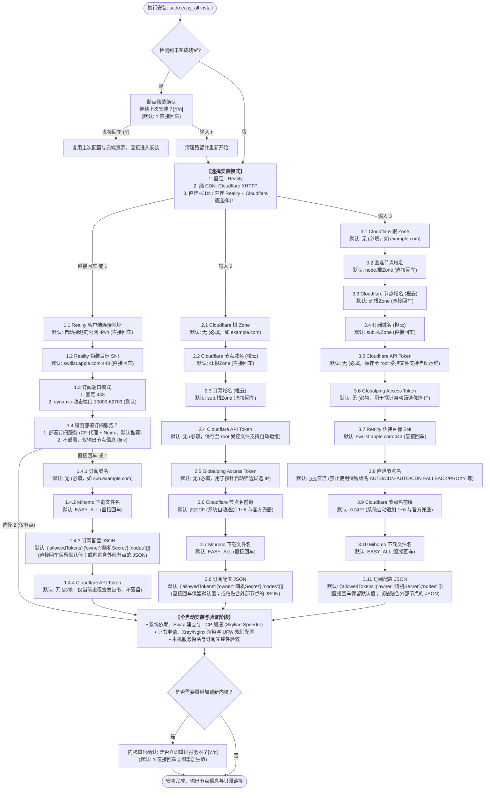
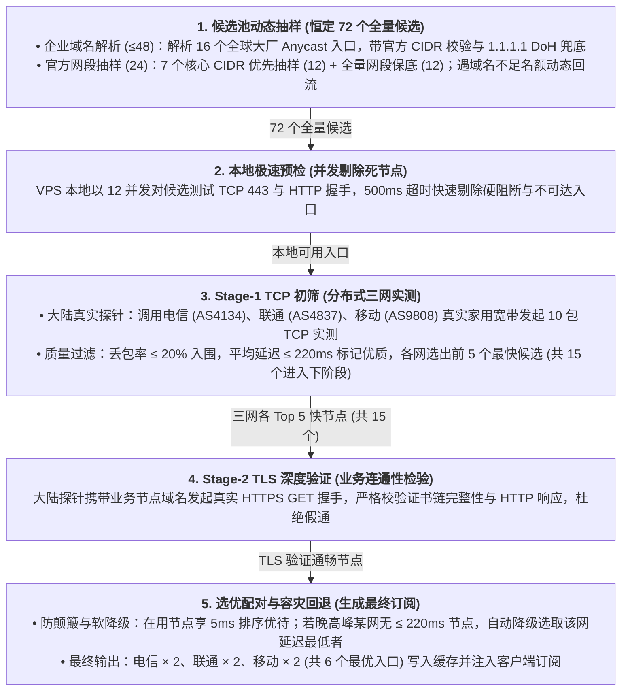

# easy_all

当前源码版本：[4.3.2](CHANGELOG.md#432-更新说明2026-11-08)。

## 文档索引

- [前置准备手册](docs/preparation-guide.md)：域名购买、Cloudflare Zone 解析、API Token 与 Globalping 获取教程
- [客户端使用指南](docs/client-guide.md)：主流 Mihomo 客户端导入、配置与分流排障
- [运维与排障指南](docs/operations-guide.md)：节点管理、用户管理、证书轮换及疑难解答
- [系统技术参考](docs/technical-reference.md)：架构设计、流控机制与网络实现原理

---

`easy_all` 是专为全新 Debian 12/13 及 Ubuntu 22.04/24.04 LTS（bookworm / trixie / jammy / noble）VPS 设计的单节点代理一键安装工具。通过控制台交互菜单直观配置，统一打通 Xray、Nginx、订阅分发、UFW 防火墙、Fail2ban 以及 TCP 加速（默认自动启用 Skyline Speeder TCP 加速，基于 Zabbly 6.12+ LTS 内核原生支持 amd64 与 arm64）。

仅支持 IPv4。一台 VPS 只能选择安装一种模式，建议在无其他业务占用的纯净 VPS 上部署。

---

## 模式选择

| 模式 | 适用场景 | 核心架构与入口 |
| :--- | :--- | :--- |
| **1. 直连 Reality** | VPS IP 纯净、直连网络良好 | VLESS TCP Reality Vision（VPS `443` 或动态端口轮换）；可选 Nginx 订阅分发（本机节点 + 聚合节点） |
| **2. 纯 CDN** | 只要 CDN 入口（VPS 直连被封或不需要直连） | **Cloudflare XHTTP（443 回源）**，统一订阅分发（聚合 + CDN-AUTO 测速 + CDN 域名官方调度兜底） |
| **3. 直连+CDN** | 一台机器同时拥有直连与 CDN 节点 | **直连 Reality（VPS `8443`） + Cloudflare XHTTP（443 回源）**，统一订阅分发（直连/聚合 + CDN-AUTO 测速 + CDN 域名官方调度兜底） |

---

## 开始前准备

### 1. SSH 保活与防止中断
安装过程包含系统更新、内核编译与网络优化，耗时约 5~15 分钟。为防止 SSH 偶发空闲断开导致安装半途终止：
- **强烈建议在 `tmux` 或 `screen` 会话中执行**。
- 本机客户端配置保活（写入本机 `~/.ssh/config`）：
  ```sshconfig
  Host *
      ServerAliveInterval 30
      ServerAliveCountMax 6
      TCPKeepAlive yes
  ```
- 万一中途连接断开，重新连接后再次运行安装命令即可：程序会自动检测安装断点并提示**继续上次安装**（保留已生成的证书与密钥配置）。

### 2. 服务器与端口要求
- **操作系统与架构**：全新 Debian 12/13 或 Ubuntu 22.04/24.04 LTS（代号 bookworm / trixie / jammy / noble，原生支持 amd64 与 arm64 架构）；
- **Swap 交换空间**：若系统未配置 Swap，安装程序将自动创建并启用 1GB 交换文件（`/swapfile`，写入 `/etc/fstab`）以保障内核编译与高并发稳定性；
  > [!TIP]
  > **极端边界说明**：物理内存 ≤ 1GB 的低配 arm64 VPS 上，Skyline Speeder 需从源码编译 Rust/BPF。程序已自动将并发限制为单任务（`CARGO_BUILD_JOBS=1`），但若磁盘可用空间不足 1.5GB 导致无法自动创建 Swap，编译期仍有触发 OOM 的潜在风险。建议在低配 arm64 环境中确保根分区剩余空间 ≥ 1.5GB 或提前配置好 Swap。
- **网络与权限**：具备公网 IPv4，root 权限，未运行其他占用 80/443 的 Nginx/Xray；
- **防火墙/安全组**：云厂商安全组放行 SSH 端口与 TCP `443`（直连+CDN 模式另需放行 TCP `8443`；直连动态端口模式另需放行 `10000-62703`）。

---

## 一键安装

登录 VPS 终端（需 root 权限），运行一键安装命令：

```bash
bash <(curl -fsSL https://raw.githubusercontent.com/v2yiz/easy_all/main/bootstrap.sh) install
```

脚本将在终端显示交互式菜单：
1. **选择安装模式**：
   - `1` 直连 - Reality（适合直连效果良好、VPS IP 未被封）
   - `2` 纯 CDN：Cloudflare XHTTP（只要 CDN 入口，不需要直连）
   - `3` 直连+CDN：直连 Reality + Cloudflare（一次部署两个入口，共享订阅）
2. **按提示输入配置**：直接回车可使用括号 `[ ]` 内的推荐默认值；部署订阅的模式 1 与两种 CDN 模式都会要求一份 `{"allowedTokens":{...},"nodes":[...]}` 订阅配置（可先留空节点）。
3. **自动安装与部署**：依赖安装、TCP 加速（默认 Skyline Speeder）、服务启动与验收全自动完成。

### 用户交互全景导图



### 交互参数与默认值一览表

| 模式 | 交互步骤 | 提示说明 | 推荐默认值（直接回车） | 输入方式与规则 |
| :--- | :--- | :--- | :--- | :--- |
| **通用** | **断点续装** | `继续上次安装？[Y/n]:` | **`Y`**（继续） | 仅在有安装残留时提示；输入 `n` 清理并重新安装 |
| **通用** | **模式选择** | `请选择 [1]:` | **`1`**（Reality） | 输入 `1` 直连 Reality，`2` 纯 CDN，`3` 直连+CDN |
| **1. Reality** | 1.1 连接地址 | `Reality 客户端连接地址` | **自动检测的公网 IPv4** | 直接回车使用探测到的 IP；或填入入站 IPv4 / 灰云域名 |
| | 1.2 伪装目标 | `Reality SNI / 伪装目标（域名:端口）` | `swdist.apple.com:443` | 直接回车使用 Apple CDN；或输入自定义 TLS 1.3 目标 |
| | 1.3 端口模式 | `请选择 [2]:` | **`2`**（dynamic） | 直接回车使用动态端口（`10000-62703`）；输入 `1` 固定 443 |
| | 1.4 订阅部署 | `请选择 [1]:` | **`1`**（部署订阅） | 直接回车部署带自适应分发的订阅；输入 `2` 为纯节点 |
| | 1.4.1 订阅域名 | `Cloudflare 代理的订阅域名` | **无**（必填） | 输入 Cloudflare 代理的子域名（如 `sub.example.com`） |
| | 1.4.2 下载名 | `Mihomo 下载文件名` | `EASY_ALL` | 直接回车使用推荐值；或自定义下载文件名 |
| | 1.4.3 订阅配置 | `订阅配置 JSON` | `{"allowedTokens":...,"nodes":[]}` | **直接回车保留默认值**（自动生成 owner Token，节点数组为空）；或粘贴自定义多用户与外部聚合节点 JSON |
| | 1.4.4 CF Token | `Cloudflare API Token` | **无**（必填） | 隐藏输入，仅当前进程签发证书使用，不落盘 |
| **2. 纯 CDN** | 2.1 根 Zone | `Cloudflare 根 Zone` | **无**（必填） | 输入已在 Cloudflare 托管的主域名（如 `example.com`） |
| | 2.2 CDN 节点域名 | `Cloudflare 节点域名（橙云）` | `cf.<根Zone>` | 直接回车使用默认值（自动配置为橙云 Proxied 回源） |
| | 2.3 订阅域名 | `订阅域名（橙云）` | `sub.<根Zone>` | 直接回车使用默认值（自动配置为橙云 Proxied 分发） |
| | 2.4 CF Token | `Cloudflare API Token` | **无**（必填） | 隐藏输入；需目标 Zone 的 DNS 与证书编辑权限（持久化保存） |
| | 2.5 GP Token | `Globalping Access Token` | **无**（必填） | 隐藏输入；用于定期三网探针筛选 6 个优选 IP（持久化保存） |
| | 2.6 CF 前缀 | `Cloudflare 节点名前缀` | `🇺🇸CF` | 直接回车；自动追加 1~6 与官方调度兜底节点 |
| | 2.7 下载名 | `Mihomo 下载文件名` | `EASY_ALL` | 直接回车使用推荐值；或自定义下载文件名 |
| | 2.8 订阅配置 | `订阅配置 JSON` | `{"allowedTokens":...,"nodes":[]}` | **直接回车保留默认值**（自动生成 owner Token，节点数组为空）；或粘贴自定义多用户与外部聚合节点 JSON |
| **3. 直连+CDN** | 3.1 根 Zone | `Cloudflare 根 Zone` | **无**（必填） | 输入已在 Cloudflare 托管的主域名（如 `example.com`） |
| | 3.2 直连域名 | `直连节点域名` | `node.<根Zone>` | 直接回车使用默认值（自动配置为灰云 DNS-only） |
| | 3.3 CDN 节点域名 | `Cloudflare 节点域名（橙云）` | `cf.<根Zone>` | 直接回车使用默认值（自动配置为橙云 Proxied 回源） |
| | 3.4 订阅域名 | `订阅域名（橙云）` | `sub.<根Zone>` | 直接回车使用默认值（自动配置为橙云 Proxied 分发） |
| | 3.5 CF Token | `Cloudflare API Token` | **无**（必填） | 隐藏输入；需目标 Zone 的 DNS 与证书编辑权限（持久化保存） |
| | 3.6 GP Token | `Globalping Access Token` | **无**（必填） | 隐藏输入；用于定期三网探针筛选 6 个优选 IP（持久化保存） |
| | 3.7 伪装目标 | `Reality 伪装目标（域名:端口）` | `swdist.apple.com:443` | 直接回车使用 Apple CDN；或输入自定义 TLS 1.3 目标 |
| | 3.8 直连节点名 | `直连节点名` | `🇺🇸直连` | 直接回车；**禁止使用保留组名**（`AUTO`、`CDN-AUTO`、`CDN-FALLBACK`、`PROXY` 等） |
| | 3.9 CF 前缀 | `Cloudflare 节点名前缀` | `🇺🇸CF` | 直接回车；自动追加 1~6 与官方调度兜底节点（不可与直连节点名同名） |
| | 3.10 下载名 | `Mihomo 下载文件名` | `EASY_ALL` | 直接回车使用推荐值；或自定义下载文件名 |
| | 3.11 订阅配置 | `订阅配置 JSON` | `{"allowedTokens":...,"nodes":[]}` | **直接回车保留默认值**（自动生成 owner Token，节点数组为空）；或粘贴自定义多用户与外部聚合节点 JSON |
| **通用** | **内核重启确认** | `是否立即重启服务器？[Y/n]:` | **`Y`**（立即重启） | 仅在升级内核时提示；直接回车立即执行 `sudo reboot` |

---

## 完成与客户端导入

安装结束后按提示重启服务器使内核与网络优化生效：
```bash
sudo reboot
```
重启后登录，查看服务状态与订阅地址：
```bash
sudo easy_all status
sudo easy_all subscription
```

- 将 `easy_all subscription` 输出的订阅链接填入客户端（如 **Clash Verge Rev / Clash Mi / Bettbox / FlClash** 等）。
- 订阅支持客户端自适应：同一条链接自动识别 UA 下发 Mihomo 规则集配置或通用 Base64。
- 更多客户端配置、规则分流与导入故障排查详见 [客户端使用指南](docs/client-guide.md)。

---

## 常用运维命令

安装完成后，全局注册了 `easy_all` 管理命令：

| 命令 | 用途说明 |
| :--- | :--- |
| `easy_all status` | 查看系统负载、TCP 加速状态、Xray/Nginx 运行状况及订阅地址 |
| `easy_all subscription` | 查看节点信息与所有用户的专属订阅链接 |
| `easy_all show` | 输出各节点详细参数、VLESS 链接及 Mihomo 代理配置块 |
| `easy_all apply` | 刷新并重新应用本机配置与订阅（不重复修改云端 DNS 与证书） |
| `easy_all apply-cloud` | （纯 CDN / 直连+CDN）同步云端资源（更新 Cloudflare DNS 解析与 Origin CA 证书） |
| `easy_all reality-target [域名:端口]` | （Reality / 直连+CDN）修改 Reality 伪装目标（自动带 SNI 验证 TLS 1.3 连通性并热更新） |
| `easy_all rotate-dynamic-ports` | （Reality 模式）立即轮换并刷新动态端口 NAT 规则 |
| `easy_all refresh-cdn-ips` | （纯 CDN / 直连+CDN）重新调用 Globalping 测试并筛选当期最佳优选 IP |
| `easy_all edit-sub` | 交互式管理订阅配置（用户 Token + 聚合节点）与订阅模板 |
| `easy_all renew-cert` | 检查并重新签发当前模式的 TLS 证书 |
| `easy_all update-core` | 在线升级 Xray 核心至官方最新稳定版 |
| `easy_all self-update` | 从 GitHub 更新 easy_all 脚本自身至最新主线版本 |
| `easy_all cleanup-partial` | 清理安装中断留下的临时残留（不影响云端资源） |
| `easy_all purge-cloudflare` | 清理 easy_all 创建的 Cloudflare 远端资源（可在未安装或状态丢失时使用） |
| `easy_all uninstall` | 卸载本机服务与配置（可选 `--purge-cloud` 同步清理 Cloudflare 远端资源）；只回收业务端口，保留 UFW 启用状态与 Fail2ban 配置 |

---

## 安全机制与防护边界

1. **SSH 自动防护**：
   - 所有模式均保留系统现有 SSH 监听端口（默认 22），UFW 默认放行该端口并阻断其余未放行入站流量。
   - 由 Fail2ban 实时监控保护实际 SSH 端口（采用专用 CIDR 防重脚本），防范自动化暴力破解。
2. **回源白名单与防扫网**：
   - 纯 CDN 与直连+CDN 的源站 443 端口仅对 Cloudflare 官方公布的回源 IPv4 网段开放，外部探测无法触达。
   - Fail2ban 的 CIDR 封禁助手脚本安装到 `/usr/local/sbin/fail2ban-ufw-cidr.sh`，与 easy_all 运行时目录解耦；卸载与安装失败回滚只回收业务端口，不会让常驻封禁动作失效。
3. **恶意流量阻断**：
   - Xray 内部路由自动丢弃局域网私有地址、云厂商元数据网段（如 169.254.169.254）以及异常回环访问。

---

## Cloudflare CDN 优选 IP 原理与实现

纯 CDN（模式 2）与直连+CDN（模式 3）采用**服务端中心化主动探测**机制：不耗费手机客户端电量与流量，由 VPS 定时（每 3 小时通过 systemd timer）调用 Globalping 分布式探针，直接从大陆三大运营商（中国电信 AS4134、中国联通 AS4837、中国移动 AS9808）的真实终端（eyeball-network）角度，经过两阶段过滤筛选出 6 个（三网各 2 个）最低延迟、低丢包且 TLS 真正通畅的优选 IP 注入订阅。

订阅同时内置**CDN 域名官方调度兜底**：除 6 个优选 IP 之外还有一个连接 `cf.<zone>` 的节点，由 Cloudflare 官方 Anycast 调度决定边缘；Mihomo 把它放在 `CDN-FALLBACK`（`fallback`）组的最后一位，只有当 `CDN-AUTO` 测速组里 6 个优选 IP 全部不可用时才启用，因此在优选 IP 整体被阻断时仍可继续使用 CDN 入口。



### 核心实现要点
1. **配额抽样与名额回流**：初筛池恒定为 72 个候选。企业大厂域名（上限 48 个）+ 优先核心 CIDR（12 个）+ 全量 CIDR（12 个）；遇域名解析不足或离线，名额自动回流给官方网段抽样，避免抽样池萎缩或单一化。
2. **防境内 DNS 污染**：企业域名解析结果必须匹配 Cloudflare 官方 CIDR，遇虚假公网 IP 污染时自动无缝回退至 `1.1.1.1` DoH 解析。
3. **两阶段防 SNI 假通**：Stage-1 先用 TCP ping 初筛三网前 15 个快节点；Stage-2 针对真实业务节点域名发起真实 HTTPS GET 握手，杜绝“TCP 端口通但 SNI 握手被 RST 阻断”的假通节点。
4. **晚高峰软降级兜底**：若某运营商在晚高峰拥堵时无可满足 $\le 220\text{ms}$ 的候选，算法自动回退取该网丢包合格中延迟最低的候选，避免一票否决导致整批崩溃。
