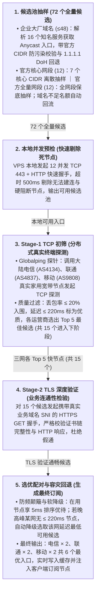

# easy_all

当前源码版本：[2.5.2](CHANGELOG.md#252-更新说明2026-11-05)。

## 文档索引

- [前置准备手册](docs/preparation-guide.md)：域名购买、Cloudflare Zone 解析、API Token 与 Globalping 获取教程
- [客户端使用指南](docs/client-guide.md)：主流 Mihomo 客户端导入、配置与分流排障
- [运维与排障指南](docs/operations-guide.md)：节点管理、用户管理、证书轮换及疑难解答
- [系统技术参考](docs/technical-reference.md)：架构设计、流控机制与网络实现原理

---

`easy_all` 是专为全新 Debian 12/13 及 Ubuntu 22.04/24.04 LTS（bookworm / trixie / jammy / noble）VPS 设计的单节点代理一键安装工具。通过控制台交互菜单直观配置，统一打通 Xray、Nginx、订阅分发、UFW 防火墙、Fail2ban 以及 TCP 加速（默认自动启用 Skyline Speeder TCP 加速，基于 Zabbly 6.12+ LTS 内核原生支持 amd64 与 arm64）。

仅支持 IPv4。一台 VPS 只能选择安装一种模式，建议在无其他业务占用的纯净 VPS 上部署。

---

## 模式选择

| 模式 | 适用场景 | 核心架构与入口 |
| :--- | :--- | :--- |
| **1. 直连 Reality** | VPS IP 纯净、直连网络良好 | VLESS TCP Reality Vision（VPS `443` 或动态端口轮换） |
| **2. Cloudflare CDN** | VPS 直连受阻、IP 被墙或需要防封 | VLESS XHTTP `stream-up` + 6 个 Cloudflare 优选 IPv4；可选独立 Worker 兜底 |
| **3. Bunny CDN** | 追求多地区边缘与自动调度 | VLESS WS/TLS（Pull Zone 自动调度域名 + Nginx HTTPS 回源） |
| **4. 组合模式** | 一台机器同时拥有直连与 CDN 节点 | **直连 Reality（VPS `8443`） + Cloudflare XHTTP（443 回源）**，统一订阅自动测速优选 |

---

## 开始前准备

### 1. SSH 保活与防止中断
安装过程包含系统更新、内核编译与网络优化，耗时约 5~15 分钟。为防止 SSH 偶发空闲断开导致安装半途终止：
- **强烈建议在 `tmux` 或 `screen` 会话中执行**。
- 本机客户端配置保活（写入本机 `~/.ssh/config`）：
  ```sshconfig
  Host *
      ServerAliveInterval 30
      ServerAliveCountMax 6
      TCPKeepAlive yes
  ```
- 万一中途连接断开，重新连接后再次运行安装命令即可：程序会自动检测安装断点并提示**继续上次安装**（保留已生成的证书与密钥配置）。

### 2. 服务器与端口要求
- **操作系统与架构**：全新 Debian 12/13 或 Ubuntu 22.04/24.04 LTS（代号 bookworm / trixie / jammy / noble，原生支持 amd64 与 arm64 架构）；
- **Swap 交换空间**：若系统未配置 Swap，安装程序将自动创建并启用 1GB 交换文件（`/swapfile`，写入 `/etc/fstab`）以保障内核编译与高并发稳定性；
  > [!TIP]
  > **极端边界说明**：物理内存 ≤ 1GB 的低配 arm64 VPS 上，Skyline Speeder 需从源码编译 Rust/BPF。程序已自动将并发限制为单任务（`CARGO_BUILD_JOBS=1`），但若磁盘可用空间不足 1.5GB 导致无法自动创建 Swap，编译期仍有触发 OOM 的潜在风险。建议在低配 arm64 环境中确保根分区剩余空间 ≥ 1.5GB 或提前配置好 Swap。
- **网络与权限**：具备公网 IPv4，root 权限，未运行其他占用 80/443 的 Nginx/Xray；
- **防火墙/安全组**：云厂商安全组放行 SSH 端口与 TCP `443`（组合模式另需放行 TCP `8443`；直连动态端口模式另需放行 `10000-62703`）。

---

## 一键安装

登录 VPS 终端（需 root 权限），运行一键安装命令：

```bash
bash <(curl -fsSL https://raw.githubusercontent.com/v2yiz/easy_all/main/bootstrap.sh) install
```

脚本将在终端显示交互式菜单：
1. **选择安装模式**：
   - `1` 直连 - Reality（适合直连效果良好、VPS IP 未被封）
   - `2` Cloudflare CDN 精选 IP（纯 VLESS XHTTP stream-up，6 个优选 IPv4）
   - `3` Bunny CDN（VLESS WS/TLS）
   - `4` 组合：直连 Reality + Cloudflare（一次部署两个入口，共享订阅）
2. **按提示输入配置**：直接回车可使用括号 `[ ]` 内的推荐默认值。
3. **自动安装与部署**：依赖安装、TCP 加速（默认 Skyline Speeder）、服务启动与验收全自动完成。

---

## 完成与客户端导入

安装结束后按提示重启服务器使内核与网络优化生效：
```bash
sudo reboot
```
重启后登录，查看服务状态与订阅地址：
```bash
sudo easy_all status
sudo easy_all subscription
```

- 将 `easy_all subscription` 输出的订阅链接填入客户端（如 **Clash Verge Rev / Clash Mi / Bettbox / FlClash** 等）。
- 订阅支持客户端自适应：同一条链接自动识别 UA 下发 Mihomo 规则集配置或通用 Base64。
- 更多客户端配置、规则分流与导入故障排查详见 [客户端使用指南](docs/client-guide.md)。

---

## 常用运维命令

安装完成后，全局注册了 `easy_all` 管理命令：

| 命令 | 用途说明 |
| :--- | :--- |
| `easy_all status` | 查看系统负载、TCP 加速状态、Xray/Nginx 运行状况及订阅地址 |
| `easy_all subscription` | 查看节点信息与所有用户的专属订阅链接 |
| `easy_all show` | 输出各节点详细参数、VLESS 链接及 Mihomo 代理配置块 |
| `easy_all apply` | 刷新并重新应用本机配置与订阅（不重复修改云端 DNS 与证书） |
| `easy_all apply-cloud` | 同步云端资源（更新 Cloudflare / Bunny 云端解析、规则与证书，或同步 Worker） |
| `easy_all reality-target [域名:端口]` | 修改 Reality 伪装目标（自动带 SNI 验证 TLS 1.3 连通性并热更新） |
| `easy_all rotate-dynamic-ports` | （Reality 模式）立即轮换并刷新动态端口 NAT 规则 |
| `easy_all refresh-cdn-ips` | 重新调用 Globalping 测试并筛选当期最佳优选 IP |
| `easy_all refresh-origin-ips` | （Bunny 模式）立即刷新 Bunny 官方回源 IPv4 防火墙白名单 |
| `easy_all edit-sub` | 交互式管理用户 Token、订阅模板以及 Worker 聚合订阅设置 |
| `easy_all renew-cert` | 检查并重新签发当前模式的 TLS 证书 |
| `easy_all update-core` | 在线升级 Xray 核心至官方最新稳定版 |
| `easy_all self-update` | 从 GitHub 更新 easy_all 脚本自身至最新主线版本 |
| `easy_all uninstall` | 卸载本机服务与配置（可选 `--purge-cloud` 同步清理 Cloudflare / Bunny 远端资源）；只回收业务端口，保留 UFW 启用状态与 Fail2ban 配置 |

---

## 安全机制与防护边界

1. **SSH 自动防护**：
   - 所有模式均保留系统现有 SSH 监听端口（默认 22），UFW 默认放行该端口并阻断其余未放行入站流量。
   - 由 Fail2ban 实时监控保护实际 SSH 端口（采用专用 CIDR 防重脚本），防范自动化暴力破解。
2. **回源白名单与防扫网**：
   - CDN 模式与组合模式的源站 443 端口仅对 Cloudflare 官方公布的回源 IPv4 网段开放，外部探测无法触达。
   - Fail2ban 的 CIDR 封禁助手脚本安装到 `/usr/local/sbin/fail2ban-ufw-cidr.sh`，与 easy_all 运行时目录解耦；卸载与安装失败回滚只回收业务端口，不会让常驻封禁动作失效。
3. **恶意流量阻断**：
   - Xray 内部路由自动丢弃局域网私有地址、云厂商元数据网段（如 169.254.169.254）以及异常回环访问。

---

## Cloudflare CDN 优选 IP 原理与实现

对于模式 2（Cloudflare CDN）与模式 4（组合模式），`easy_all` 采用**服务端中心化主动探测**机制：不耗费手机客户端电量与流量，由 VPS 定时（每 3 小时通过 systemd timer）调用 Globalping 分布式探针，直接从大陆三大运营商（中国电信 AS4134、中国联通 AS4837、中国移动 AS9808）的真实终端（eyeball-network）角度，经过两阶段过滤筛选出 6 个（三网各 2 个）最低延迟、低丢包且 TLS 真正通畅的优选 IP 注入订阅。



### 核心实现要点
1. **配额抽样与名额回流**：初筛池恒定为 72 个候选。企业大厂域名（上限 48 个）+ 优先核心 CIDR（12 个）+ 全量 CIDR（12 个）；遇域名解析不足或离线，名额自动回流给官方网段抽样，避免抽样池萎缩或单一化。
2. **防境内 DNS 污染**：企业域名解析结果必须匹配 Cloudflare 官方 CIDR，遇虚假公网 IP 污染时自动无缝回退至 `1.1.1.1` DoH 解析。
3. **两阶段防 SNI 假通**：Stage-1 先用 TCP ping 初筛三网前 15 个快节点；Stage-2 针对真实业务节点域名发起真实 HTTPS GET 握手，杜绝“TCP 端口通但 SNI 握手被 RST 阻断”的假通节点。
4. **晚高峰软降级兜底**：若某运营商在晚高峰拥堵时无可满足 $\le 220\text{ms}$ 的候选，算法自动回退取该网丢包合格中延迟最低的候选，避免一票否决导致整批崩溃。
