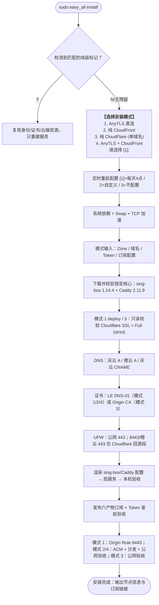

# easy_all

当前源码版本：[5.0.0](CHANGELOG.md#500-更新说明2026-11-10)。

## 文档索引

- [前置准备手册](docs/preparation-guide.md)：域名购买、Cloudflare Zone 解析、API Token 获取教程
- [AWS 准备指南](docs/aws-guide.md)：AWS 账号、ACM/CloudFront 最小权限 IAM 策略与访问密钥
- [客户端使用指南](docs/client-guide.md)：主流 Mihomo 客户端导入、配置与分流排障
- [运维与排障指南](docs/operations-guide.md)：节点管理、用户管理、证书轮换及疑难解答
- [系统技术参考](docs/technical-reference.md)：架构设计、流控机制与网络实现原理

---

`easy_all` 是专为全新 Debian 12/13 及 Ubuntu 22.04/24.04 LTS（bookworm / trixie / jammy / noble）VPS 设计的单节点代理一键安装工具。通过控制台交互菜单直观配置，统一打通 sing-box（AnyTLS / VLESS WebSocket）、Caddy 订阅分发、UFW 防火墙、Fail2ban 以及 TCP 加速（默认自动启用 Skyline Speeder TCP 加速，基于 Zabbly 6.12+ LTS 内核原生支持 amd64 与 arm64）。

仅支持 IPv4。一台 VPS 只能选择安装一种模式，建议在无其他业务占用的纯净 VPS 上部署。

---

## 模式选择

四模式共用同一套本机运行时：官方 sing-box 提供节点入站，官方 Caddy 提供订阅与 CDN 回源入口。
**本机节点与全部订阅入口统一使用 443**（直连 443、CloudFront viewer 443、橙云回源 443）；
模式 1 的订阅站点与模式 4 的源站在 `8443`，不是客户端端口。

| 模式 | 适用场景 | 客户端入口 | VPS 本机监听 | 证书 | UFW 业务端口 |
| :--- | :--- | :--- | :--- | :--- | :--- |
| **1. AnyTLS 直连** | VPS IP 纯净、直连良好 | `direct:443`；可选 `https://sub/subscribe` | sing-box `0.0.0.0:443`；Caddy `0.0.0.0:8443`（仅 deploy） | Let's Encrypt（DNS-01） | 公网 443；8443 仅 Cloudflare IPv4 |
| **2. 纯 CloudFront** | 只要 CDN 入口 | `cf:443`；`https://sub/subscribe`（默认同 cf） | sing-box `127.0.0.1:10086`；Caddy `0.0.0.0:443` | ACM（viewer）+ LE（源站，DNS-01） | 公网 443 |
| **3. 纯 CloudFlare（单域名）** | 只要 CDN 入口且回源只对 Cloudflare 开放 | `cf:443`；`https://cf/subscribe` | sing-box `127.0.0.1:10086`；Caddy `0.0.0.0:443` | Cloudflare Origin CA | 443 仅 Cloudflare IPv4 |
| **4. AnyTLS + CloudFront** | 同时要直连与 CDN | `direct:443`、`cf:443`；`https://sub/subscribe` | sing-box `0.0.0.0:443` + `127.0.0.1:10086`；Caddy `0.0.0.0:8443` | LE（direct/origin）+ ACM（viewer） | 公网 443、8443 |

- 模式 1 的 `deploy/link`：`link` 只输出节点，不建订阅站点、不建 Origin Rule。
- 所有模式保留实际 SSH 端口；不新增公网 80、不提供 HTTP 重定向、不监听对外 UDP 443。
- 本版唯一受支持的 CDN 传输是 **WebSocket**；`httpupgrade` 延后，不提供安装选项。
- 用户订阅 JSON 中的外部聚合节点保留原 `host/port/portRange`，不强制改写为 443。

### DNS 与代理状态（固定）

| 模式 | 记录 |
| :--- | :--- |
| 1 | direct：灰云 A → VPS；deploy 的 sub：橙云 A → VPS |
| 2 | origin：灰云 A → VPS；cf/sub：灰云 CNAME → CloudFront 分发 |
| 3 | cf：橙云 A → VPS，同时承载节点与订阅 |
| 4 | direct/origin：灰云 A → VPS；cf/sub：灰云 CNAME → 分发 |

安装与 `apply-cloud` 会先读同名全部记录，校验类型/`proxied`/地址/归属；同名 AAAA、类型或代理状态冲突、
非受管记录一律阻止写入，不自动接管。

### 模式 2/4（CloudFront）链路

1. Cloudflare 权威 DNS：origin/direct 灰云 A，cf/sub 灰云 CNAME → 分发。
2. AWS ACM（固定 `us-east-1`）：viewer 证书，SAN 覆盖节点与订阅域名。
3. CloudFront：viewer HTTPS 443，源站 HTTPS/TLS1.2，转发 query 与 WebSocket 必需头，不启用 gRPC。
4. 源站 Let's Encrypt 证书（Cloudflare DNS-01，不开放 80）：模式 2 源站 443、模式 4 源站 8443。
5. 源站密钥 `X-Easy-All-Origin-Key`：仅由 CloudFront 注入，Caddy 在 route 首位用 CEL 精确比较，
   不相等即 `abort`；密钥不进入客户端订阅。
6. Caddy → sing-box：`/vless-...` 精确路径转发到 `127.0.0.1:10086`（VLESS WebSocket），订阅走 Token 鉴权。

### 模式 3（Cloudflare 橙云）链路

1. 节点域名橙云 A 记录，Cloudflare 边缘终结 TLS 并回源；**Zone SSL/TLS 必须为 Full (strict)**，
   安装只读校验（需要 Zone Settings Read），不是 strict 就在创建任何资源前停止。
2. Cloudflare Origin CA（ECDSA P-256，15 年）作为回源证书。
3. VPS 443 只放行 Cloudflare 官方回源 IPv4 段（`easy_all-cf-origin-443`）。
4. 单域名 Caddy 站点同时提供 `/easy_all-health`、WebSocket 代理路径与 `/subscribe`。

> [!WARNING]
> Cloudflare 官方禁止利用反向代理传输 VPN/代理流量及使用优选 IP，存在封号封域风险，请自行评估使用。

### 从 4.x 升级

schema 0 状态与旧安装标记**不会被接管**：请先用 4.x 的 `sudo easy_all uninstall`（需要时加
`--purge-cloud`）卸载，再用 5.0 重新安装。本版本不做自动迁移，也不保留旧栈（Xray/Nginx/Reality/
动态端口/XHTTP/模式 5）兼容实现。

---

## 开始前准备

### 1. SSH 保活与防止中断
安装过程包含系统更新、内核编译与网络优化，耗时约 5~15 分钟。为防止 SSH 偶发空闲断开导致安装半途终止：
- **强烈建议在 `tmux` 或 `screen` 会话中执行**。
- 本机客户端配置保活（写入本机 `~/.ssh/config`）：
  ```sshconfig
  Host *
      ServerAliveInterval 30
      ServerAliveCountMax 6
      TCPKeepAlive yes
  ```
- 万一中途连接断开，重新连接后再次运行安装命令即可。**续装只在 `SCHEMA=1` 的安装标记、链路身份与安装前快照都匹配时提供**，会复用已生成的证书、分发 ID/ACM ARN（模式 2/4）、Origin CA 身份（模式 3）。模式 1（AnyTLS）不参与续装，只能清理后重装；旧版本标记以及链路不匹配的残留同样不参与续装，只能清理后重新安装；非交互场景遇到残留需先执行 `sudo easy_all cleanup-partial`。

### 2. 服务器与端口要求
- **操作系统与架构**：全新 Debian 12/13 或 Ubuntu 22.04/24.04 LTS（代号 bookworm / trixie / jammy / noble，原生支持 amd64 与 arm64 架构）；
- **Swap 交换空间**：若系统未配置 Swap，安装程序将自动创建并启用 1GB 交换文件（`/swapfile`，写入 `/etc/fstab`）以保障内核编译与高并发稳定性；
  > [!TIP]
  > **极端边界说明**：物理内存 ≤ 1GB 的低配 arm64 VPS 上，Skyline Speeder 需从源码编译 Rust/BPF。程序已自动将并发限制为单任务（`CARGO_BUILD_JOBS=1`），但若磁盘可用空间不足 1.5GB 导致无法自动创建 Swap，编译期仍有触发 OOM 的潜在风险。建议在低配 arm64 环境中确保根分区剩余空间 ≥ 1.5GB 或提前配置好 Swap。
- **网络与权限**：具备公网 IPv4，root 权限，未运行其他占用 443/8443/10086 的代理或 Web 服务；
- **防火墙/安全组**：云厂商安全组放行 SSH 端口，并按模式放行：
  | 模式 | 必需放行的 TCP 端口 |
  | :--- | :--- |
  | 1 AnyTLS 直连 | `443`（直连入口）；订阅 deploy 另加 `8443`（橙云回源，仅 Cloudflare 官方回源 IPv4 段） |
  | 2 纯 CloudFront | `443`（源站，公网可达：CloudFront 回源没有固定 IP 段） |
  | 3 纯 CloudFlare（单域名） | `443`（橙云回源，仅 Cloudflare 官方回源 IPv4 段） |
  | 4 AnyTLS + CloudFront | `443`（直连）+ `8443`（源站，公网可达） |

  **本版本不开放 80**：所有公信证书都走 Cloudflare DNS-01，不需要 HTTP-01 校验，也没有 HTTP 重定向。

  > [!IMPORTANT]
  > 模式 1 有两条不同用途的端口：`443` 是 AnyTLS **直连入口**（对客户端开放）；`8443` 是订阅域名经
  > Cloudflare 橙云代理时的**回源端口**（只对 Cloudflare 官方回源 IPv4 段开放）。
  > 模式 4 反向：`443` 是直连、`8443` 是 CloudFront 源站。

### 3. 凭据与域名准备
- **Cloudflare API Token**（按模式取最小权限）：
  | 模式 | Zone 范围权限 |
  | :--- | :--- |
  | 1 link | Zone Read、DNS Edit |
  | 1 deploy | Zone Read、DNS Edit、Zone Settings Read、Origin Rules Edit |
  | 2 / 4 | Zone Read、DNS Edit |
  | 3 | Zone Read、DNS Edit、Zone Settings Read、SSL and Certificates Edit |

  Token 以 `0600` 保存到 `/etc/easy_all/cloudflare.token` 供后续云端同步与卸载清理复用；
  DNS-01 凭据以 `0600` 保存到 `/etc/easy_all/cloudflare.ini` 以便 Certbot 定时续期。
- **证书与 strict**：模式 1 deploy 与模式 3 会在创建任何 DNS/证书/规则前只读校验 Zone SSL 模式，
  只接受 **Full (strict)**；full/flexible/off 需要人工修改后重试，工具不会自动改全区设置。
- **AWS Access Key / Secret Access Key**：**只有模式 2/4** 需要一对专用 IAM 用户密钥，登录时隐藏输入，**只存在于当前进程内存，不写入 state、身份文件、日志或订阅**。模式 1/3 完全不提示、不安装、不调用 AWS。创建步骤见 [AWS 准备指南](docs/aws-guide.md)。
- **域名规划**（必须是同一个 active Cloudflare Zone 下的子域名，不支持根域名或通配符）：

  | 用途 | 模式 1 | 模式 2 | 模式 3 | 模式 4 | 记录要求 |
  | :--- | :--- | :--- | :--- | :--- | :--- |
  | 直连 `node.<zone>` | 必填 | 无 | 无 | 必填 | 灰云 `A` → VPS 公网 IPv4 |
  | 源站 `origin.<zone>` | 无 | 必填 | 无 | 必填 | 灰云 `A` → VPS；不得等于节点或订阅域名 |
  | CDN 节点 `cf.<zone>` | 无 | 必填 | 必填 | 必填 | 模式 2/4 灰云 `CNAME` → 分发；模式 3 橙云 `A` → VPS |
  | 订阅 `sub.<zone>` | deploy 必填 | 必填（默认同节点） | 无（同节点域名） | 必填（默认同节点） | 模式 1 deploy 与模式 3 的实际记录见上表 |

  因此模式 1 deploy 需要 2 个名字（link 只需直连）、模式 2 至少 2 个、模式 3 只需 1 个、
  模式 4 默认 3 个（直连与源站复用域名时可减为 2 个）。

---

## 一键安装

登录 VPS 终端（需 root 权限），运行一键安装命令：

```bash
bash <(curl -fsSL https://raw.githubusercontent.com/v2yiz/easy_all/main/bootstrap.sh) install
```

脚本将在终端显示交互式菜单：
1. **选择安装模式**：
   - `1` AnyTLS 直连（适合直连效果良好、VPS IP 未被封；订阅可选 deploy/link）
   - `2` 纯 CloudFront：AWS CloudFront + VLESS WebSocket（只要 CDN 入口）
   - `3` 纯 CloudFlare：橙云单域名同时提供节点与订阅，回源只对 Cloudflare 开放
   - `4` AnyTLS + CloudFront：直连 443 与 CloudFront 一次部署，订阅含两个本机节点
2. **按提示输入配置**：直接回车可使用括号 `[ ]` 内的推荐默认值；四种模式都会要求一份 `{"allowedTokens":{...},"nodes":[...]}` 订阅配置（可先留空节点）。
3. **自动安装与部署**：依赖安装、TCP 加速（默认 Skyline Speeder）、证书申请、云端分发/解析与订阅验收全自动完成；模式 2/4 最后会校验流量保护定时器已启用。

### 用户交互全景导图



### 交互参数与默认值一览表

| 模式 | 交互步骤 | 提示说明 | 推荐默认值（直接回车） | 输入方式与规则 |
| :--- | :--- | :--- | :--- | :--- |
| **通用** | 断点续装 | `继续上次安装？[Y/n]:` | `Y` | 仅当 `SCHEMA=1` 标记、链路身份与安装前快照都匹配时提示；旧版本标记与不匹配残留只能清理后重装 |
| **通用** | 模式选择 | `请选择 [1]:` | `1`（AnyTLS 直连） | `1` 直连 / `2` 纯 CloudFront / `3` 纯 CloudFlare / `4` AnyTLS+CloudFront |
| **通用** | 定时重启 | `请选择 [1]:` | `1`（每天凌晨 4 点） | `2` 自定义 `0-23` 小时；`3` 不配置 |
| **通用** | 订阅配置 | `订阅配置 JSON` | `{"allowedTokens":...,"nodes":[]}` | 直接回车保留默认值（自动生成 owner Token）；或粘贴多用户与外部聚合节点 JSON |
| **1/4** | 直连域名 | `直连节点域名（灰云 A 记录指向本机）` | `node.<Zone>` | 必须是当前 Zone 下的子域名 |
| **1/4** | 直连节点名 | `直连节点名` | `🇺🇸直连` | 1–64 字符，不能用保留组名（AUTO/PROXY/...） |
| **1** | 订阅模式 | `请选择 [1]:` | `1`（部署订阅） | `2` 只输出节点（link）：不建 Caddy 站点、不建 Origin Rule |
| **1 deploy** | 订阅域名 | `订阅域名（橙云代理，回源 8443）` | `sub.<Zone>` | 必须与直连域名不同 |
| **2/4** | 根 Zone | `Cloudflare 根 Zone（如 example.com）` | 无（必填） | 已在 Cloudflare 托管的根域名 |
| **2/4** | 源站域名 | `源站域名（解析至 VPS，灰云直连）` | `origin.<Zone>` | 自动创建灰云 `A`；不得等于节点/订阅域名 |
| **2/4** | 节点域名 | `CloudFront 节点域名（CNAME 指向分发，灰云）` | `cf.<Zone>` | 自动创建灰云 `CNAME` |
| **2/4** | 订阅域名 | `订阅域名（可与节点域名相同）` | 节点域名 | 可与节点域名复用同一记录 |
| **2/4** | 节点名 | `CloudFront 节点名（完整单节点名）` | `🇺🇸AWS` | 订阅里的 CDN 节点名 |
| **3** | 节点域名 | `CDN 节点域名（橙云代理，同时提供节点与订阅）` | `cf.<Zone>` | 一个域名同时承载节点与订阅 |
| **2/3/4** | CDN 路径 | 自动生成 | `/vless-<随机>` | 不提示；精确匹配代理路径 |
| **1/2/4** | Certbot | 自动 | — | Cloudflare API Token 由 DNS-01 使用；凭据 `0600` 保存 |
| **2/4** | AWS 凭据 | `AWS Access Key ID / Secret` | 无（必填） | 隐藏输入，仅当前进程内存 |
| **通用** | Cloudflare Token | `Cloudflare API Token` | 无（必填） | 隐藏输入；按模式要求最小权限（见上表） |
| **通用** | 下载文件名 | `Mihomo 下载文件名（不含 .yaml）` | `EASY_ALL` | 只允许字母数字点下划线短横线 |

## 完成与客户端导入

安装结束后按提示重启服务器使内核与网络优化生效：
```bash
sudo reboot
```
重启后登录，查看服务状态与订阅地址：
```bash
sudo easy_all status
sudo easy_all subscription
```

- 将 `easy_all subscription` 输出的订阅链接填入客户端（如 **Clash Verge Rev / Clash Mi / Bettbox / FlClash** 等）。
- 订阅支持客户端自适应：同一条链接自动识别 UA 下发 Mihomo 规则集配置或通用 Base64；追加 `&flag=clash`、`&flag=base64`、`&os=ios`、`&node=all` 可强制格式、iOS 变体或附带聚合节点。
- 模式 2/4 的 CDN 节点固定连接 CloudFront 节点域名，模式 3 固定连接橙云节点域名。模式 4 在 `PROXY` 组内提供 `AUTO`（url-test）与 `CDN-FALLBACK`（直连优先的 fallback），也可手动选择任一实际节点；订阅内没有优选 IP。
- 更多客户端配置、规则分流与导入故障排查详见 [客户端使用指南](docs/client-guide.md)。

---

## 常用运维命令

安装完成后，全局注册了 `easy_all` 管理命令：

| 命令 | 用途说明 |
| :--- | :--- |
| `easy_all install` | 交互选择 1 AnyTLS 直连 / 2 纯 CloudFront / 3 纯 CloudFlare / 4 AnyTLS+CloudFront 并安装 |
| `easy_all status` | 查看系统负载、TCP 加速状态、sing-box/Caddy 运行状况、监听端口、证书与流量保护额度 |
| `easy_all subscription` | 查看节点信息与所有用户的专属订阅链接 |
| `easy_all show` | 输出各节点详细参数、VLESS 链接及 Mihomo 代理配置块 |
| `easy_all apply` | 应用已安装配置：只重建本机与订阅，不访问云管理 API（仍会读取公开的 Cloudflare 回源网段） |
| `easy_all apply-cloud` | 同步云端资源：模式 1 是 direct/可选 sub DNS、证书与 Origin Rule；模式 2/4 是 DNS + ACM + CloudFront 分发 + 源站证书；模式 3 是橙云 A 记录与 Origin CA |
| `easy_all cdn-traffic-sync` | （仅模式 2/4）采样 mangle 计量并落实流量阻断 |
| `easy_all edit-sub` | 交互式管理订阅配置（用户 Token + 聚合节点）与订阅模板 |
| `easy_all renew-cert` | 重新签发/部署当前模式的 TLS 证书 |
| `easy_all update-core` | 重装/修复当前锁定版本的核心（sing-box 1.14.4 + Caddy 2.11.9），不追最新 |
| `easy_all self-update [--dev\|--branch <分支>]` | 从 GitHub 更新 easy_all 脚本自身；默认 `main`，`--dev` 使用 `dev` 分支 |
| `easy_all cleanup-partial` | 清理上次中断安装留下的本机残留（不改云端资源） |
| `easy_all purge-cloudflare` | 清理 easy_all 创建的 Cloudflare 资源（可在未安装状态使用） |
| `easy_all uninstall` | 卸载当前模式；可追加 `--purge-cloud` 清理托管的远端资源；只回收业务端口，保留 UFW 启用状态与 Fail2ban 配置 |
| `easy_all help` | 显示帮助 |

> `apply`、`edit-sub` 都不调用云管理 API；需要改云端时用 `apply-cloud`（`renew-cert` 在模式 3 会调用 Cloudflare 证书 API 轮换 Origin CA）。
> 已删除的命令：`reality-target`、`rotate-dynamic-ports`。

---

## 安全机制与防护边界

1. **SSH 自动防护**：
   - 所有模式均保留系统现有 SSH 监听端口（默认 22），UFW 默认放行该端口并阻断其余未放行入站流量。
   - 由 Fail2ban 实时监控保护实际 SSH 端口（采用专用 CIDR 防重脚本），防范自动化暴力破解。
2. **源站暴露面**：
   - **模式 1** 的订阅回源端口是 `8443`，只对 Cloudflare 官方回源 IPv4 段开放；直连 443 对公网开放。
   - **模式 2/4 的 443/8443 对公网可达**：CloudFront 回源没有固定 IP 段，因此没有 Cloudflare 回源白名单。
     源站安全依赖公信 Let's Encrypt 证书、源站密钥 `X-Easy-All-Origin-Key`（Caddy route 首位 CEL 比较，
     不相等即 abort）、精确代理路径、VLESS UUID 与订阅 Token 鉴权。这些措施不能防御网络层 DDoS、
     TLS/HTTP 资源耗尽或密钥泄露。
   - **模式 3 的 443 只对 Cloudflare 官方回源 IPv4 段放行**（`easy_all-cf-origin-443`），并要求
     Zone SSL/TLS 为 Full (strict)。这是公共回源网段，不是账户级鉴权。
   - 订阅入口只精确匹配 `/subscribe` 与 `/sub`；`/subscribe/`、`/subscribed` 与其他路径返回 404。
     公共头（Vary/Cache-Control/Pragma/nosniff/noindex）先于任何终止响应；非 GET/HEAD 405、
     Token 缺失或错误 403、未就绪 503。
   - 重复 `token` 参数由 Caddy 逗号拼接，不能匹配合法 Token，一律 403；重复 `flag`/`os`/`node`
     回落默认行为。这是相对旧版 `$arg_*` 取首值的有意收紧。
   - **不开放 80**：证书统一走 Cloudflare DNS-01（Cloudflare 凭据 0600 持久保存以便续期）。
   - Fail2ban 的 CIDR 封禁助手脚本安装到 `/usr/local/sbin/fail2ban-ufw-cidr.sh`；卸载与安装失败回滚
     只回收业务端口，不会让常驻封禁动作失效。
3. **恶意流量阻断**：
   - sing-box 路由先解析域名，再拒绝私有/特殊地址集合（回环、元数据、CGNAT、多播与保留段），并保留 UDP/443 拒绝。

---

## CloudFront 链路与 985GB 本机近似计量保护

模式 2/4 采用 AWS 全球 Anycast 调度的 CloudFront 分发域名作为 CDN 入口，订阅包含该节点（模式 4 另加 AnyTLS 直连节点）。

### 1. 分发配置要点
由脚本通过 AWS CLI 生成，无需手工点击控制台：

- **Viewer**：别名 = 节点域名（订阅域名不同则一并加入），ACM `us-east-1` 证书、`sni-only`、`TLSv1.2_2021`、`https-only`、HTTP/2。
- **行为**：缓存策略 `CachingDisabled`，源站请求策略 `AllViewerExceptHostHeader`（转发 query、User-Agent、Content-Type 等），7 种 HTTP 方法（不启用 gRPC）。
- **源站**：`origin.<zone>`、`https-only`、源站 TLS 1.2、自定义头 `X-Easy-All-Origin-Key`，连接/读取时限沿用固定值。

### 2. 流量保护如何工作

1. 计数在 `mangle` 表用链首无 target 的纯计数规则完成：`INPUT` 匹配 `lo` + `127.0.0.1` + TCP `10086` 计上行，`OUTPUT` 匹配同条件计下行；模式 4 的 AnyTLS 流量不经过 10086，不计入。
2. systemd timer `easy_all-cdn-traffic-guard.timer` 每 15 秒执行一次 `easy_all cdn-traffic-sync`，把累计字节写入 `/etc/easy_all/cdn-traffic-usage.json`（`0600`，原子写入）。
3. 达到 **985 GB（十进制 985×10⁹ 字节）** 后，脚本执行双层阻断：Caddy 的代理路径先返回 `503`，再由 sing-box 省略 CDN 入站并重启以终止已建立的 CDN 长连接；`enforced` 只在旧连接确认断开后置 true。
4. 阻断只针对 CDN：模式 4 的 AnyTLS 直连短暂重连后继续可用，订阅链接始终可用。
5. 每月 **UTC 自然月** 切换后额度重新计算；达到阈值后的状态会持久化在 usage 文件里，`apply`、`update-core`、`apply-cloud` 都不会绕过阻断，需由定时器或手动 `sudo easy_all cdn-traffic-sync` 收敛。

查看当前用量：

```bash
sudo easy_all status
# CloudFront 全局费用保护: enabled（UTC 自然月 2026-11，阈值 985 GB）
#   已统计: 12.345 GB，剩余保护空间: 972.655 GB，blocked=false，enforced=false，protection_offline=false
```

### 3. 这是近似保护，不是账单保证

- 阈值由**本机 mangle 回环计数**近似得出，不是 AWS 账单真源：订阅下载、HTTP/TLS 握手与请求费、其他分发或其他机器产生的用量不在统计内；重启、规则重建、关机窗口会换计数 epoch 并重采样基线，可能漏计。计数含 TCP/IP 开销。
- 因此本机保护只能降低超额风险，**不承诺零账单，也不是任何形式的账单保底**。CloudFront 的免费额度与计费标准以你 AWS 账号当前的条款和账单为准。
- 若 `status` 显示流量保护异常（`统计文件缺失或损坏`、定时器 inactive），应先停用 CDN 节点并修复，而不是清空 usage 文件绕过额度。

---

## Cloudflare 橙云链路（模式 3）

模式 3 采用 Cloudflare 橙云代理作为 CDN 入口：

- **单域名**：节点域名配置一条橙云 `A` 记录，同时提供 VLESS WebSocket 入站与 `/subscribe` 订阅；Origin CA 证书 CN/SAN 为该域名。
- **证书**：使用 Cloudflare Origin CA（ECDSA P-256、15 年有效期）。
- **回源白名单**：VPS `443` 端口仅对 Cloudflare 官方公布的回源 IPv4 段放行（UFW 注释 `easy_all-cf-origin-443`）。
- **Cloudflare 侧设置**：SSL/TLS 设为 **Full (strict)**（只接受 strict）；橙云节点域名保持边缘证书就绪。
- **运维**：`apply` 重建本机与订阅；`apply-cloud` 同步 DNS 与 Origin CA；`renew-cert` 轮换 Origin CA 证书；`uninstall --purge-cloud` 级联清理云端解析与证书。
