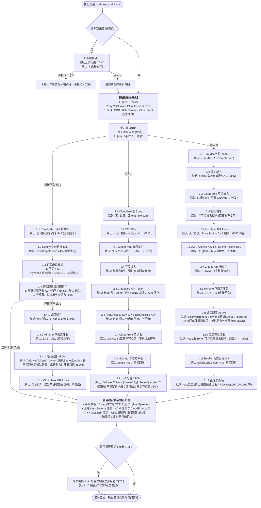

# easy_all

当前源码版本：[4.3.2](CHANGELOG.md#432-更新说明2026-11-08)。

## 文档索引

- [前置准备手册](docs/preparation-guide.md)：域名购买、Cloudflare Zone 解析、API Token 获取教程
- [AWS 准备指南](docs/aws-guide.md)：AWS 账号、ACM/CloudFront 最小权限 IAM 策略与访问密钥
- [客户端使用指南](docs/client-guide.md)：主流 Mihomo 客户端导入、配置与分流排障
- [运维与排障指南](docs/operations-guide.md)：节点管理、用户管理、证书轮换及疑难解答
- [系统技术参考](docs/technical-reference.md)：架构设计、流控机制与网络实现原理

---

`easy_all` 是专为全新 Debian 12/13 及 Ubuntu 22.04/24.04 LTS（bookworm / trixie / jammy / noble）VPS 设计的单节点代理一键安装工具。通过控制台交互菜单直观配置，统一打通 Xray、Nginx、订阅分发、UFW 防火墙、Fail2ban 以及 TCP 加速（默认自动启用 Skyline Speeder TCP 加速，基于 Zabbly 6.12+ LTS 内核原生支持 amd64 与 arm64）。

仅支持 IPv4。一台 VPS 只能选择安装一种模式，建议在无其他业务占用的纯净 VPS 上部署。

---

## 模式选择

| 模式 | 适用场景 | 核心架构与入口 |
| :--- | :--- | :--- |
| **1. 直连 Reality** | VPS IP 纯净、直连网络良好 | VLESS TCP Reality Vision（VPS `443` 或动态端口轮换）；可选 Nginx 订阅分发（本机节点 + 聚合节点） |
| **2. 纯 CDN（CloudFront）** | 只要 CDN 入口（VPS 直连被封或不需要直连） | Cloudflare 权威 DNS（灰云）→ AWS ACM → CloudFront（`443`）→ 源站 Let's Encrypt + `X-Easy-All-Origin-Key` 头校验 → Nginx → Xray XHTTP；订阅分发含本机单 CDN 节点 + 聚合节点 |
| **3. 直连+CloudFront** | 一台机器同时拥有直连与 CDN 节点 | 模式 2 的 CloudFront 链路 + 直连 Reality（VPS `8443`）；订阅同时含直连与 CDN 两个本机节点 |

模式 2/3 的链路固定为下面六段，没有第三方 CDN 优选、探针测速或自动兜底节点：

1. **Cloudflare 只做权威 DNS**：源站与直连域名是灰云 A 记录（指向 VPS 公网 IPv4），节点与订阅域名是灰云 CNAME（指向 CloudFront 分发域名），全程不开启橙云代理。
2. **AWS ACM（固定 `us-east-1`）**：为 CloudFront 签发 viewer 证书，SAN 覆盖节点域名与订阅域名。
3. **CloudFront 分发**：`sni-only`、viewer/origin 均 `https-only`、TLS 1.2_2021、缓存关闭、7 种方法 + gRPC、转发全部 query/User-Agent/Content-Type；不启用 WAF、访问日志、Origin Shield 或 Route 53。
4. **源站 Let's Encrypt 证书**：只覆盖源站域名，CloudFront 以 `https-only` 回源并按源站域名校验 SNI/Host。
5. **`X-Easy-All-Origin-Key` 源站头**：CloudFront 注入，Nginx 校验；健康探针、XHTTP 与订阅入口都依赖它。
6. **Nginx → Xray**：Nginx 把 XHTTP 精确路径转发到 `127.0.0.1:10086`，并把 gRPC Host 固定为节点域名；订阅走 Token 鉴权。

> [!IMPORTANT]
> **旧版本状态不支持接管**：旧版 `PROTOCOL=cdn`（橙云 XHTTP）和旧版橙云 `combined` 安装无法在当前版本继续运行。请先执行 `sudo easy_all uninstall`（默认保留云端资源），再重新 `sudo easy_all install` 选择模式 2 或 3。重装会产生新的 UUID / 路径 / Token，客户端必须重新导入新订阅链接。

---

## 开始前准备

### 1. SSH 保活与防止中断
安装过程包含系统更新、内核编译与网络优化，耗时约 5~15 分钟。为防止 SSH 偶发空闲断开导致安装半途终止：
- **强烈建议在 `tmux` 或 `screen` 会话中执行**。
- 本机客户端配置保活（写入本机 `~/.ssh/config`）：
  ```sshconfig
  Host *
      ServerAliveInterval 30
      ServerAliveCountMax 6
      TCPKeepAlive yes
  ```
- 万一中途连接断开，重新连接后再次运行安装命令即可：程序会自动检测安装断点并提示**继续上次安装**（保留已生成的证书与密钥配置）。

### 2. 服务器与端口要求
- **操作系统与架构**：全新 Debian 12/13 或 Ubuntu 22.04/24.04 LTS（代号 bookworm / trixie / jammy / noble，原生支持 amd64 与 arm64 架构）；
- **Swap 交换空间**：若系统未配置 Swap，安装程序将自动创建并启用 1GB 交换文件（`/swapfile`，写入 `/etc/fstab`）以保障内核编译与高并发稳定性；
  > [!TIP]
  > **极端边界说明**：物理内存 ≤ 1GB 的低配 arm64 VPS 上，Skyline Speeder 需从源码编译 Rust/BPF。程序已自动将并发限制为单任务（`CARGO_BUILD_JOBS=1`），但若磁盘可用空间不足 1.5GB 导致无法自动创建 Swap，编译期仍有触发 OOM 的潜在风险。建议在低配 arm64 环境中确保根分区剩余空间 ≥ 1.5GB 或提前配置好 Swap。
- **网络与权限**：具备公网 IPv4，root 权限，未运行其他占用 80/443 的 Nginx/Xray；
- **防火墙/安全组**：云厂商安全组放行 SSH 端口，并按模式放行：
  | 模式 | 必需放行的 TCP 端口 |
  | :--- | :--- |
  | 1 直连 Reality | Reality 直连 `443`（固定端口）或 `10000-62703`（动态端口）；**订阅部署另加 `8443`**（Cloudflare 橙云回源，仅 Cloudflare 官方回源 IPv4 段） |
  | 2 纯 CDN（CloudFront） | `80` + `443` |
  | 3 直连+CloudFront | `80` + `443` + Reality 直连 `8443` |

  `80` 端口只用于 Let's Encrypt HTTP-01 验证：首次签发和自动续期都需要它，安全组未放行会直接导致证书申请失败。

  > [!IMPORTANT]
  > 模式 1 有两条不同用途的端口：`443` 或动态端口是 Reality **直连入口**（对客户端开放）；`8443` 是订阅域名经 Cloudflare 橙云代理时的**回源端口**（只对 Cloudflare 官方回源 IPv4 段开放）。把订阅回源写成 `443` 会直接导致 521/525 握手失败。

### 3. 凭据与域名准备
- **Cloudflare API Token**：模式 2/3 只需要 `Zone / Zone / Read` 与 `Zone / DNS / Edit`（无需证书权限），输入的 Token 以 `0600` 保存到 `/etc/easy_all/cloudflare.token` 供后续 `apply-cloud` 与卸载清理复用；模式 1 的订阅部署除 DNS 外还另需证书权限，且 Token 不落盘。
- **AWS Access Key / Secret Access Key**：模式 2/3 需要一对专用 IAM 用户密钥，登录时隐藏输入，**只存在于当前进程内存，不写入 state、身份文件、日志或订阅**。创建步骤见 [AWS 准备指南](docs/aws-guide.md)。
- **域名规划**（必须是同一个 active Cloudflare Zone 下的子域名，不支持根域名或通配符）：

  | 用途 | 模式 2 | 模式 3 | 记录要求 |
  | :--- | :--- | :--- | :--- |
  | 源站 `origin.<zone>` | 必填 | 必填 | 灰云 `A` → VPS 公网 IPv4；不得等于节点或订阅域名 |
  | CloudFront 节点 `cf.<zone>` | 必填 | 必填 | 灰云 `CNAME` → CloudFront 分发域名 |
  | 订阅（默认与节点同名） | 必填 | 必填 | 与节点同名时不另建记录；不同则为灰云 `CNAME` → 分发 |
  | 直连 Reality `node.<zone>` | 无 | 必填 | 灰云 `A` → VPS 公网 IPv4；可与源站域名复用，但不得等于节点/订阅域名 |

  因此模式 2 至少需要 2 个名字，模式 3 默认 3 个（直连域名与源站复用时可减为 2 个）。

---

## 一键安装

登录 VPS 终端（需 root 权限），运行一键安装命令：

```bash
bash <(curl -fsSL https://raw.githubusercontent.com/v2yiz/easy_all/main/bootstrap.sh) install
```

脚本将在终端显示交互式菜单：
1. **选择安装模式**：
   - `1` 直连 - Reality（适合直连效果良好、VPS IP 未被封）
   - `2` 纯 CDN：AWS CloudFront XHTTP（只要 CDN 入口，不需要直连）
   - `3` 直连+CDN：直连 Reality + CloudFront（一次部署两个入口，共享订阅）
2. **按提示输入配置**：直接回车可使用括号 `[ ]` 内的推荐默认值；三种模式都会要求一份 `{"allowedTokens":{...},"nodes":[...]}` 订阅配置（可先留空节点）。
3. **自动安装与部署**：依赖安装、TCP 加速（默认 Skyline Speeder）、证书申请、CloudFront 分发与订阅验收全自动完成；模式 2/3 最后会校验流量保护定时器已启用。

### 用户交互全景导图



### 交互参数与默认值一览表

| 模式 | 交互步骤 | 提示说明 | 推荐默认值（直接回车） | 输入方式与规则 |
| :--- | :--- | :--- | :--- | :--- |
| **通用** | **断点续装** | `继续上次安装？[Y/n]:` | **`Y`**（继续） | 仅在有安装残留时提示；输入 `n` 清理并重新安装 |
| **通用** | **模式选择** | `请选择 [1]:` | **`1`**（Reality） | 输入 `1` 直连 Reality，`2` 纯 CDN，`3` 直连+CDN |
| **通用** | **定时重启** | `请选择 [1]:` | **`1`**（每天凌晨 4 点） | 输入 `2` 自定义 `0-23` 小时；`3` 不配置定时重启 |
| **1. Reality** | 1.1 连接地址 | `Reality 客户端连接地址` | **自动检测的公网 IPv4** | 直接回车使用探测到的 IP；或填入入站 IPv4 / 灰云域名 |
| | 1.2 伪装目标 | `Reality SNI / 伪装目标（域名:端口）` | `swdist.apple.com:443` | 直接回车使用 Apple CDN；或输入自定义 TLS 1.3 目标 |
| | 1.3 端口模式 | `请选择 [2]:` | **`2`**（dynamic） | 直接回车使用动态端口（`10000-62703`）；输入 `1` 固定 443 |
| | 1.4 订阅部署 | `请选择 [1]:` | **`1`**（部署订阅） | 直接回车部署带自适应分发的订阅；输入 `2` 为纯节点 |
| | 1.4.1 订阅域名 | `Cloudflare 代理的订阅域名` | **无**（必填） | 输入 Cloudflare 代理的子域名（如 `sub.example.com`） |
| | 1.4.2 下载名 | `Mihomo 下载文件名` | `EASY_ALL` | 直接回车使用推荐值；或自定义下载文件名 |
| | 1.4.3 订阅配置 | `订阅配置 JSON` | `{"allowedTokens":...,"nodes":[]}` | **直接回车保留默认值**（自动生成 owner Token，节点数组为空）；或粘贴自定义多用户与外部聚合节点 JSON |
| | 1.4.4 CF Token | `Cloudflare API Token` | **无**（必填） | 隐藏输入，仅当前进程签发证书使用，不落盘 |
| **2. 纯 CDN（CloudFront）** | 2.1 根 Zone | `Cloudflare 根 Zone（如 example.com）` | **无**（必填） | 输入已在 Cloudflare 托管的主域名（如 `example.com`） |
| | 2.2 源站域名 | `源站域名（解析至 VPS，灰云直连）` | `origin.<根Zone>` | 直接回车使用默认值（自动创建灰云 `A` 记录） |
| | 2.3 节点域名 | `CloudFront 节点域名（CNAME 指向分发，灰云）` | `cf.<根Zone>` | 直接回车使用默认值（自动创建灰云 `CNAME`） |
| | 2.4 订阅域名 | `订阅域名（可与节点域名相同）` | **节点域名** | 直接回车与节点域名复用同一记录；也可另填如 `sub.<根Zone>` |
| | 2.5 CF Token | `Cloudflare API Token（Zone 只读 + DNS 编辑权限）` | **无**（必填） | 隐藏输入；`0600` 保存至 `/etc/easy_all/cloudflare.token` |
| | 2.6 AWS 凭据 | `AWS Access Key ID` / `AWS Secret Access Key` | **无**（必填） | 隐藏输入，仅内存使用，不落盘；详见 [AWS 准备指南](docs/aws-guide.md) |
| | 2.7 节点名 | `CloudFront 节点名（完整单节点名）` | `🇺🇸AWS` | 1–64 字符；这是完整节点名，不再自动追加序号或“官方”兜底节点 |
| | 2.8 下载名 | `Mihomo 下载文件名` | `EASY_ALL` | 直接回车使用推荐值；或自定义下载文件名 |
| | 2.9 订阅配置 | `订阅配置 JSON` | `{"allowedTokens":...,"nodes":[]}` | **直接回车保留默认值**（自动生成 owner Token，节点数组为空）；或粘贴自定义多用户与外部聚合节点 JSON |
| **3. 直连+CDN** | 3.1 根 Zone | `Cloudflare 根 Zone（如 example.com）` | **无**（必填） | 输入已在 Cloudflare 托管的主域名（如 `example.com`） |
| | 3.2 源站域名 | `源站域名（解析至 VPS，灰云直连）` | `origin.<根Zone>` | 直接回车使用默认值（自动创建灰云 `A` 记录） |
| | 3.3 节点域名 | `CloudFront 节点域名（CNAME 指向分发，灰云）` | `cf.<根Zone>` | 直接回车使用默认值（自动创建灰云 `CNAME`） |
| | 3.4 订阅域名 | `订阅域名（可与节点域名相同）` | **节点域名** | 直接回车与节点域名复用同一记录；也可另填如 `sub.<根Zone>` |
| | 3.5 CF Token | `Cloudflare API Token（Zone 只读 + DNS 编辑权限）` | **无**（必填） | 隐藏输入；`0600` 保存至 `/etc/easy_all/cloudflare.token` |
| | 3.6 AWS 凭据 | `AWS Access Key ID` / `AWS Secret Access Key` | **无**（必填） | 隐藏输入，仅内存使用，不落盘；详见 [AWS 准备指南](docs/aws-guide.md) |
| | 3.7 节点名 | `CloudFront 节点名（完整单节点名）` | `🇺🇸AWS` | 1–64 字符；不可与直连节点名或保留组名重名 |
| | 3.8 下载名 | `Mihomo 下载文件名` | `EASY_ALL` | 直接回车使用推荐值；或自定义下载文件名 |
| | 3.9 订阅配置 | `订阅配置 JSON` | `{"allowedTokens":...,"nodes":[]}` | **直接回车保留默认值**（自动生成 owner Token，节点数组为空）；或粘贴自定义多用户与外部聚合节点 JSON |
| | 3.10 直连域名 | `直连节点域名（可与源站域名相同：origin.<根Zone>）` | `node.<根Zone>` | 直接回车用独立子域；或填源站域名复用同一条灰云 `A`（不得等于节点/订阅域名） |
| | 3.11 伪装目标 | `Reality 伪装目标（域名:端口）` | `swdist.apple.com:443` | 直接回车使用 Apple CDN；或输入自定义 TLS 1.3 目标 |
| | 3.12 直连节点名 | `直连节点名` | `🇺🇸直连` | 直接回车；**禁止使用保留组名**（`PROXY`、`GLOBAL`、`AUTO` 等） |
| **通用** | **内核重启确认** | `是否立即重启服务器？[Y/n]:` | **`Y`**（立即重启） | 仅在升级内核时提示；直接回车立即执行 `sudo reboot` |

---

## 完成与客户端导入

安装结束后按提示重启服务器使内核与网络优化生效：
```bash
sudo reboot
```
重启后登录，查看服务状态与订阅地址：
```bash
sudo easy_all status
sudo easy_all subscription
```

- 将 `easy_all subscription` 输出的订阅链接填入客户端（如 **Clash Verge Rev / Clash Mi / Bettbox / FlClash** 等）。
- 订阅支持客户端自适应：同一条链接自动识别 UA 下发 Mihomo 规则集配置或通用 Base64；追加 `&flag=clash`、`&flag=base64`、`&os=ios`、`&node=all` 可强制格式、iOS 变体或附带聚合节点。
- 模式 2/3 的 CDN 节点固定连接 CloudFront 节点域名，订阅内没有优选 IP、测速组或自动兜底组；模式 3 的直连与 CDN 之间**手动切换**（`PROXY` 组里选择实际节点）。
- 更多客户端配置、规则分流与导入故障排查详见 [客户端使用指南](docs/client-guide.md)。

---

## 常用运维命令

安装完成后，全局注册了 `easy_all` 管理命令：

| 命令 | 用途说明 |
| :--- | :--- |
| `easy_all install` | 交互选择 Reality、纯 CDN（CloudFront）或直连+CDN 并安装 |
| `easy_all status` | 查看系统负载、TCP 加速状态、Xray/Nginx 运行状况、订阅地址与流量保护额度 |
| `easy_all subscription` | 查看节点信息与所有用户的专属订阅链接 |
| `easy_all show` | 输出各节点详细参数、VLESS 链接及 Mihomo 代理配置块 |
| `easy_all apply` | 应用已安装配置；纯 CDN 与直连+CDN 只重建本机与订阅，不访问云 API |
| `easy_all apply-cloud` | （纯 CDN / 直连+CDN）同步云端资源：Cloudflare DNS、AWS ACM 与 CloudFront 分发、源站证书 |
| `easy_all reality-target [域名:端口]` | （Reality / 直连+CDN）修改 Reality 伪装目标（自动带 SNI 验证 TLS 1.3 连通性并热更新） |
| `easy_all rotate-dynamic-ports` | （Reality 模式）立即轮换并刷新动态端口 NAT 规则 |
| `easy_all cdn-traffic-sync` | （纯 CDN / 直连+CDN）同步 CloudFront CDN 用量并落实流量阻断 |
| `easy_all edit-sub` | 交互式管理订阅配置（用户 Token + 聚合节点）与订阅模板 |
| `easy_all renew-cert` | 重新签发/部署当前模式的 TLS 证书 |
| `easy_all update-core` | 更新当前模式的核心（Xray） |
| `easy_all self-update [--dev\|--branch <分支>]` | 从 GitHub 更新 easy_all 脚本自身；默认 `main`，`--dev` 使用 `dev` 分支 |
| `easy_all cleanup-partial` | 清理上次中断安装留下的本机残留（不改云端资源） |
| `easy_all purge-cloudflare` | 清理 easy_all 创建的 Cloudflare 资源（可在未安装状态使用） |
| `easy_all uninstall` | 卸载当前模式；可追加 `--purge-cloud` 清理托管的远端资源；只回收业务端口，保留 UFW 启用状态与 Fail2ban 配置 |
| `easy_all help` | 显示帮助 |

> 模式 2/3 的 `apply`、`edit-sub`、`renew-cert` 都不会调用 AWS/Cloudflare 云 API；需要改云端时用 `apply-cloud`。

---

## 安全机制与防护边界

1. **SSH 自动防护**：
   - 所有模式均保留系统现有 SSH 监听端口（默认 22），UFW 默认放行该端口并阻断其余未放行入站流量。
   - 由 Fail2ban 实时监控保护实际 SSH 端口（采用专用 CIDR 防重脚本），防范自动化暴力破解。
2. **源站暴露面**：
   - **模式 1** 的订阅回源端口是 `8443`（不是 Reality 直连的 `443` 或动态端口），仍只对 Cloudflare 官方回源 IPv4 网段开放。
   - **模式 2/3 的 443 对公网可达**：CloudFront 回源没有固定 IP 段，因此不再有 Cloudflare 回源白名单。源站安全依赖公信 Let's Encrypt 证书、443 默认拒绝未知 SNI（`ssl_reject_handshake`）、随机 XHTTP 路径、`X-Easy-All-Origin-Key` 源站头校验以及 VLESS UUID / 订阅 Token 鉴权。这些措施不能防御网络层 DDoS、TLS/HTTP 资源耗尽或密钥泄露。
   - **80 端口** 只响应 `/.well-known/acme-challenge/`（Let's Encrypt HTTP-01）与其他路径 404，不提供订阅或代理；安全组必须放行。
   - Fail2ban 的 CIDR 封禁助手脚本安装到 `/usr/local/sbin/fail2ban-ufw-cidr.sh`，与 easy_all 运行时目录解耦；卸载与安装失败回滚只回收业务端口，不会让常驻封禁动作失效。
3. **恶意流量阻断**：
   - Xray 内部路由自动丢弃局域网私有地址、云厂商元数据网段（如 169.254.169.254）以及异常回环访问。

---

## CloudFront 链路与 985GB 本机近似计量保护

模式 2/3 不再使用优选 IP 与探针测速。CDN 入口只有一个由 AWS 全球 Anycast 调度的 CloudFront 分发域名，订阅里本机节点也只有它一个（模式 3 另加一个直连 Reality 节点）。

### 1. 分发配置要点
由脚本通过 AWS CLI 生成，无需手工点击控制台：

- **Viewer**：别名 = 节点域名（订阅域名不同则一并加入），ACM `us-east-1` 证书、`sni-only`、`TLSv1.2_2021`、`https-only`、HTTP/2。
- **行为**：缓存策略 `CachingDisabled`，源站请求策略 `AllViewerExceptHostHeader`（转发 query、User-Agent、Content-Type 等），7 种 HTTP 方法 + gRPC，不启用 WAF、访问日志、Origin Shield、Route 53。
- **源站**：`origin.<zone>`、`https-only`、源站 TLS 1.2、自定义头 `X-Easy-All-Origin-Key`，连接/读取时限沿用固定值。

### 2. 流量保护如何工作

1. Xray 额外监听 `127.0.0.1:10085` 暴露 StatsService，只统计 XHTTP 入站（`vless-xhttp-in`）的上行/下行字节；模式 3 的 Reality 流量不计入。
2. systemd timer `easy_all-cdn-traffic-guard.timer` 每 15 秒执行一次 `easy_all cdn-traffic-sync`，把累计字节写入 `/etc/easy_all/cdn-traffic-usage.json`（`0600`，原子写入）。
3. 达到 **985 GB（十进制 985×10⁹ 字节）** 后，脚本执行双层阻断：Nginx 的 XHTTP 位置直接返回 `503`，同时 Xray 清空 XHTTP 入站客户端并重启以终止已建立的 CDN 长连接。
4. 阻断只针对 CDN：模式 3 的 Reality 直连短暂重连后继续可用（只是手动切回直连），订阅链接仍能正常下载。
5. 每月 **UTC 自然月** 切换后额度重新计算；达到阈值后的状态会持久化在 usage 文件里，`apply`、`update-core`、`apply-cloud` 都不会绕过阻断，需由定时器或手动 `sudo easy_all cdn-traffic-sync` 收敛。

查看当前用量：

```bash
sudo easy_all status
# CloudFront 全局费用保护: enabled（UTC 自然月 2026-11，阈值 985 GB）
#   已统计: 12.345 GB，剩余保护空间: 972.655 GB，blocked=false，enforced=false，protection_offline=false
```

### 3. 这是近似保护，不是账单保证

- 阈值由**本机 Xray 入站计数**近似得出，不是 AWS 账单真源：订阅下载、HTTP/TLS 握手与请求费、其他分发或其他机器产生的用量不在统计内，进程崩溃或关机窗口也可能漏计。
- 因此本机保护只能降低超额风险，**不承诺零账单，也不是任何形式的账单保底**。CloudFront 的免费额度与计费标准以你 AWS 账号当前的条款和账单为准。
- 若 `status` 显示流量保护异常（`统计文件缺失或损坏`、定时器 inactive），应先停用 CDN 节点并修复，而不是清空 usage 文件绕过额度。
