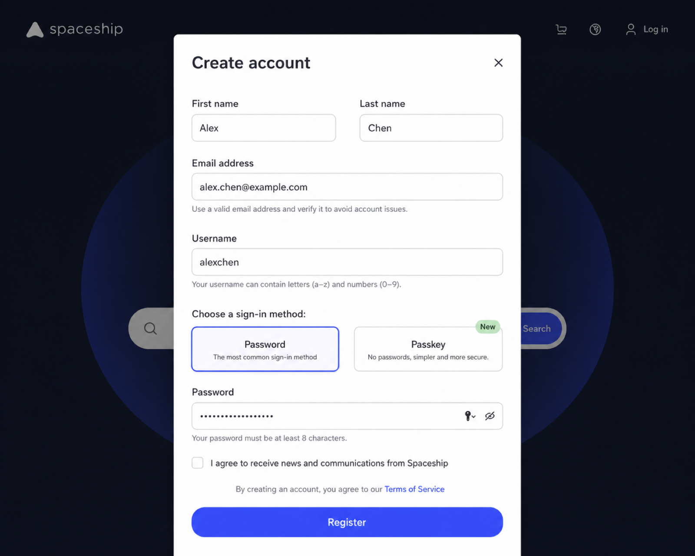
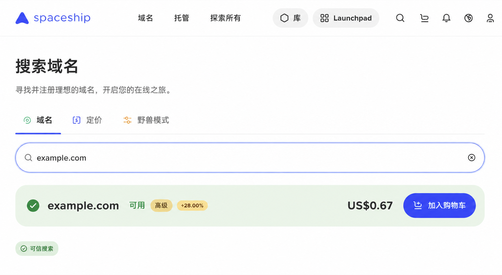
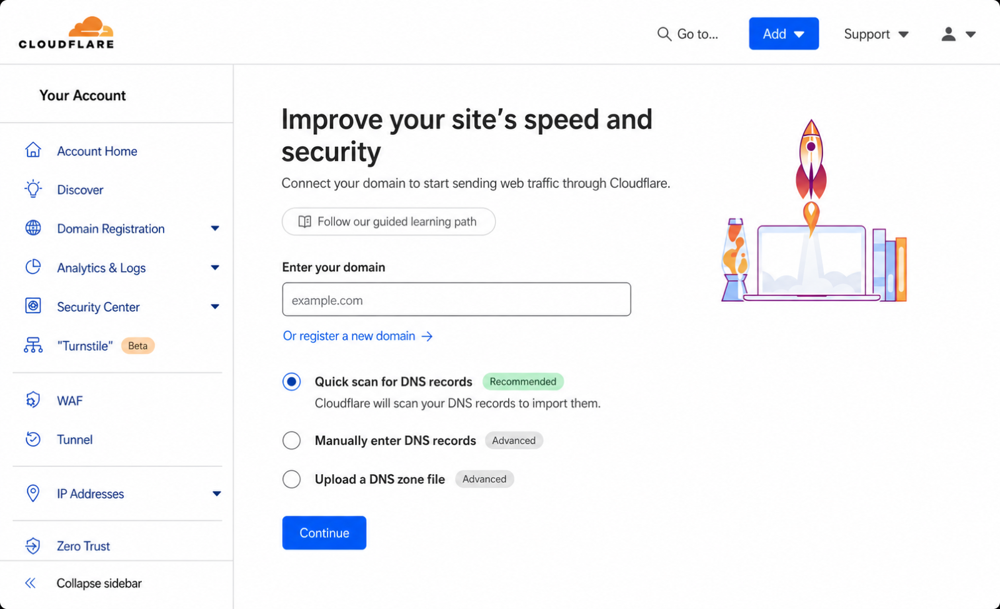
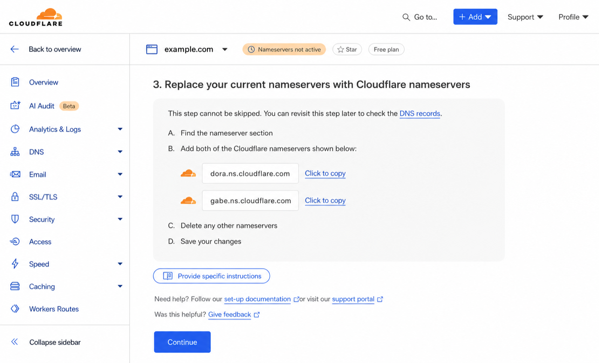
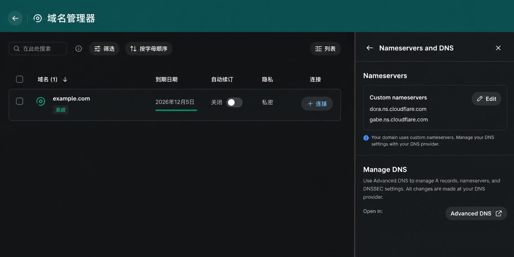
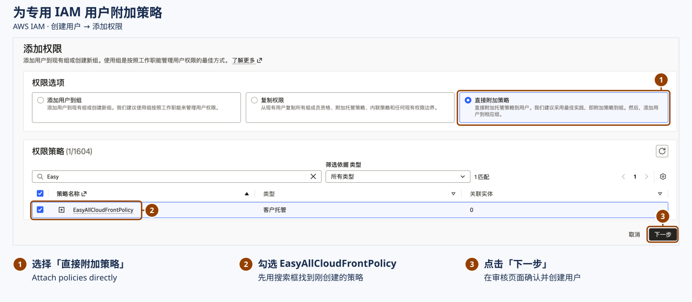
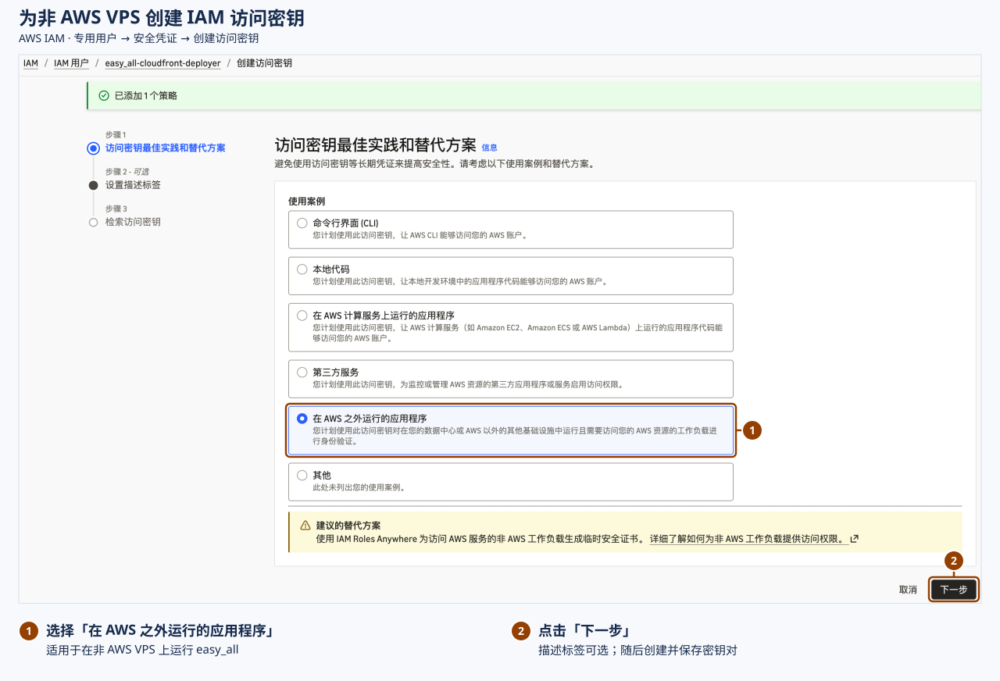

# 前置准备手册

本手册介绍使用 `easy_all` 部署各个模式前，需要在域名注册商、Cloudflare 和 AWS 准备的资源与凭据：**域名注册与 Cloudflare 托管**、**Cloudflare API Token**（全模式）与 **AWS 访问密钥**（仅模式 4/5）。

## 凭据需求一览

| 部署模式 | Cloudflare API Token 权限要求 | AWS 访问密钥（IAM） |
| :--- | :--- | :---: |
| **模式 1 AnyTLS 直连** | `link`: Zone Read + DNS Edit<br>`deploy`: Zone Read + DNS Edit + Zone Settings Read + Origin Rules Edit | 不需要 |
| **模式 2 纯 CloudFlare** | Zone Read + DNS Edit + Zone Settings Read + SSL and Certificates Edit | 不需要 |
| **模式 3 AnyTLS + CloudFlare** | Zone Read + DNS Edit + Zone Settings Read + Origin Rules Edit | 不需要 |
| **模式 4 纯 CloudFront** | Zone Read + DNS Edit | **需要** |
| **模式 5 AnyTLS + CloudFront** | Zone Read + DNS Edit | **需要** |

---

## 1. 域名注册与 Cloudflare 托管

### 1.1 域名注册（Spaceship）

部署代理服务需要一个由你控制的顶级域名（根域名，例如 `example.xyz`），推荐使用 [Spaceship](https://www.spaceship.com/) 注册：

> [!TIP]
> **核心技巧：6 位数字及以上 `.xyz`（注册首年 + 续费 9 年）**
> - **特别强调：必须是 6 位数字及以上纯数字**（例如 `123456.xyz`、`891234.xyz`、`987654321.xyz` 等）。这是 `.xyz` 注册局的专属特惠规则，**字母、英文单词或 5 位及以下数字不享受该优惠**（续费会恢复常规原价每年约 $10+）。
> - **购买策略：注册首年，续费 9 年**。在 Spaceship 搜索未被注册的 6 位及以上纯数字 `.xyz`，加入购物车后，**选择注册 1 年并直接续费 9 年（一次性购满 10 年）**。
> - 这样平均每年成本仅需几元人民币，10 年总价仅约几十元，是性价比最高的域名方案。下单前在结算页面核对首年价与续费总额即可。

注册完成后，保存好 Spaceship 账号、到期日与恢复邮箱。





### 1.2 在 Cloudflare 添加域名

`easy_all` 依赖 Cloudflare 权威 DNS 自动化管理解析记录及签发证书（免费计划即可满足全模式需求）：

1. 打开 [Cloudflare 注册页](https://dash.cloudflare.com/sign-up)，注册并登录账号。
2. 进入 [Cloudflare Dashboard](https://dash.cloudflare.com/)，点击 **Add a domain**，输入刚注册的根域名（例如 `example.com`）。
3. 方案选择 **Free**（免费计划即可）。



4. Cloudflare 会自动为该域名分配两条专属权威名称服务器（Nameservers，例如 `ns1.cloudflare.com` 与 `ns2.cloudflare.com`），复制这两条服务器地址。



### 1.3 在域名注册商修改名称服务器（DNS 委派）

1. 回到你的域名注册商控制面板，找到域名的 **DNS / Nameservers** 管理页面。
2. 将默认的名称服务器修改为自定义，完整填入 Cloudflare 给出的两条名称服务器并保存。



3. 等待全球 DNS 传播生效（通常数分钟到数小时），刷新 Cloudflare 控制台，直到域名状态出现绿色勾选并显示 **Active**（或提示 **Your domain is now protected by Cloudflare**）。必须确认状态变为 Active 后再继续后续步骤。


### 1.4 本项目对域名的规划与要求

- **全模式使用同一 Zone 下的一级子域名**：所有模式都使用同一个 Zone 下的一级子域名（如 `node.example.com`、`cf.example.com`），根域名（apex）本身只用于托管 Zone，不作为客户端节点名；多级子域名（如 `a.b.example.com`）不在 Cloudflare 默认边缘证书覆盖范围内：模式 1/2/3 的**订阅域名与 CDN 节点域名**在安装交互中直接拒绝；直连域名走 Certbot 签发，可用多级子域名；模式 4/5 的节点域名由 ACM 申请，需自行确认证书能否覆盖。
- **切勿提前在控制台手动添加子域名 DNS 记录**：安装器会在运行期间通过 API 自动检查、创建和绑定对应的 A 记录或 CNAME。
- **旧记录冲突清理**：若域名此前使用过并留有同名 A、AAAA 或 CNAME 记录，建议在安装前先在 Cloudflare 控制台手动清理冲突记录。

---

## 2. Cloudflare API Token 准备（全模式）

部署时需提供已托管目标域名的 Cloudflare API Token，用于自动化 DNS 解析、证书签发与回源规则配置。

### 2.1 权限明细对照

请遵循最小权限原则，仅授予目标 Zone（`Specific zone`）所需的权限：

| 权限分类与项目 | 适用模式 | 作用说明 |
| :--- | :--- | :--- |
| `Zone / Zone / Read` | 全模式 (1-5) | 读取目标 Zone 状态与 ID |
| `DNS / Zone / Edit` | 全模式 (1-5) | 自动管理 A、CNAME 及 ACM/Certbot DNS 验证记录 |
| `Zone Settings / Zone / Read` | 模式 1 deploy / 模式 2 / 模式 3 | 校验 Zone SSL/TLS 是否为 `Full (strict)` |
| `Origin Rules / Zone / Edit` | 模式 1 deploy / 模式 3 | 维护订阅/节点回源 8443 端口的 Origin Rule |
| `SSL and Certificates / Zone / Edit` | 模式 2 | 签发与管理 Cloudflare Origin CA 证书 |

> [!NOTE]
> - **模式 4/5** 边缘证书由 AWS ACM 托管，Cloudflare 仅作权威 DNS，**只需 Zone Read 与 DNS Edit**。
> - Token 在安装时输入，以 `0600` 权限安全保存于 VPS 本机 `/etc/easy_all/cloudflare.token`。

### 2.2 控制台创建步骤

1. 登录 [Cloudflare 控制台](https://dash.cloudflare.com/)，进入右上角头像 → **My Profile** → **API Tokens** → **Create Token**。
2. 选择 **Start with a Zone policy**（或 Create Custom Token）。
3. **Scope 范围**：`Zone Resources` 选 `Include` → `Specific zone` → 选择本次部署使用的域名 Zone。
4. **Permissions 权限**：根据上表添加所选模式需要的权限项。
5. 点击 **Continue to summary** 并创建，妥善保存生成的 Token。


---

## 3. AWS 凭证准备（仅模式 4/5）

模式 4 与模式 5 使用 AWS CloudFront 分发与 AWS Certificate Manager (ACM) viewer 证书。模式 1、2、3 无需 AWS 凭据。

### 3.1 注册与登录 AWS 账号

1. **注册使用根用户邮箱**：如果没有 AWS 全球商业区的独立账号，打开 [AWS 独立账号注册入口（Sign up for AWS Advanced）](https://signin.aws.amazon.com/signup?request_type=register)，填写 **Root user email address（根用户邮箱）** 和 **AWS account name（AWS 账号名称）**。已有账号可跳过注册。此流程无需创建 AWS 项目，不适用于 AWS 中国区账号。
2. **首次登录选 Root user，不要选 IAM user**：打开 [AWS 管理控制台](https://console.aws.amazon.com/)，用注册时的根用户邮箱登录。如果页面默认显示 IAM 用户登录，点击 **Sign in using root user email** 切换。

- **证书固定区域**：CloudFront 的 viewer 证书必须位于 **`us-east-1`（弗吉尼亚北部）**，脚本固定在此区域调用 ACM 申请与校验。
- **内存安全使用**：AWS 密钥在安装时输入，**仅暂存于当前进程内存，不落盘**（不写入 state、日志或订阅）；亦可通过环境变量 `AWS_ACCESS_KEY_ID` 与 `AWS_SECRET_ACCESS_KEY` 预先传入。
- **费用保护**：本机内置 985 GB 近似流量计量保护，达到阈值自动阻断 CDN 入口，降低超额扣费风险。

### 3.2 创建 IAM 策略与专用用户

#### 第一步：创建最小权限策略

1. 按 §3.1 登录 AWS 控制台后，进入 **IAM** → **Policies（策略）** → **Create policy**。
2. 切换到 **JSON** 标签页，粘贴以下策略并命名为 `EasyAllCloudFrontPolicy`：

```json
{
  "Version": "2012-10-17",
  "Statement": [
    {
      "Sid": "ACMCertificateManagement",
      "Effect": "Allow",
      "Action": [
        "acm:RequestCertificate",
        "acm:DescribeCertificate",
        "acm:AddTagsToCertificate",
        "acm:ListCertificates",
        "acm:ListTagsForCertificate",
        "acm:DeleteCertificate"
      ],
      "Resource": "*",
      "Condition": {
        "StringEquals": {
          "aws:RequestedRegion": "us-east-1"
        }
      }
    },
    {
      "Sid": "CallerIdentity",
      "Effect": "Allow",
      "Action": ["sts:GetCallerIdentity"],
      "Resource": "*"
    },
    {
      "Sid": "CloudFrontDistributionManagement",
      "Effect": "Allow",
      "Action": [
        "cloudfront:CreateDistribution",
        "cloudfront:GetDistribution",
        "cloudfront:GetDistributionConfig",
        "cloudfront:UpdateDistribution",
        "cloudfront:ListDistributions",
        "cloudfront:DeleteDistribution"
      ],
      "Resource": "*"
    }
  ]
}
```

#### 第二步：创建用户并附加策略

1. 在 IAM 中进入 **Users（用户）** → **Create user**，用户名填写 `easy_all-cloudfront-deployer`（**切勿勾选**提供控制台访问权限）。
2. 选择 **Attach policies directly（直接附加策略）**，搜索并勾选 `EasyAllCloudFrontPolicy`，点击 **下一步**，在审核页面确认并创建用户。

   

#### 第三步：创建并保存访问密钥

1. 在 **IAM → Users（用户）** 打开 `easy_all-cloudfront-deployer`，进入 **Security credentials（安全凭证）** → **Access keys（访问密钥）** → **Create access key（创建访问密钥）**。
2. 如果 `easy_all` 运行在非 AWS 的 VPS 上，在 **使用案例** 中选 **在 AWS 之外运行的应用程序**，然后点击 **下一步**。

   

3. **设置描述标签**可跳过，也可填 `easy_all-cloudfront` 方便识别，然后点击 **创建访问密钥**。
4. 在 **检索访问密钥** 页面妥善保存同一对密钥，部署时分别填入安装器的 AWS 密钥提示：
   - **Access Key ID** → `AWS_ACCESS_KEY_ID`
   - **Secret Access Key** → `AWS_SECRET_ACCESS_KEY`（仅在创建时可获取，离开页面前保存）

**安装时只使用上述专用 IAM 用户的密钥，不要创建或使用根用户的 Access Key。**

> [!TIP]
> **新 AWS 账号开通提示**：若账号注册于 2021 年末之后，首次创建 CloudFront 分发时若报 `Your account must be verified`，前往 [AWS Support](https://console.aws.amazon.com/support/home) 提交工单（类别 `Account and billing` → `Account verification`）申请开通 CloudFront 生产访问。工单通常需要 24 小时以上才有人处理；批准后重新运行安装将自动幂等复用已创建的证书与 DNS。
