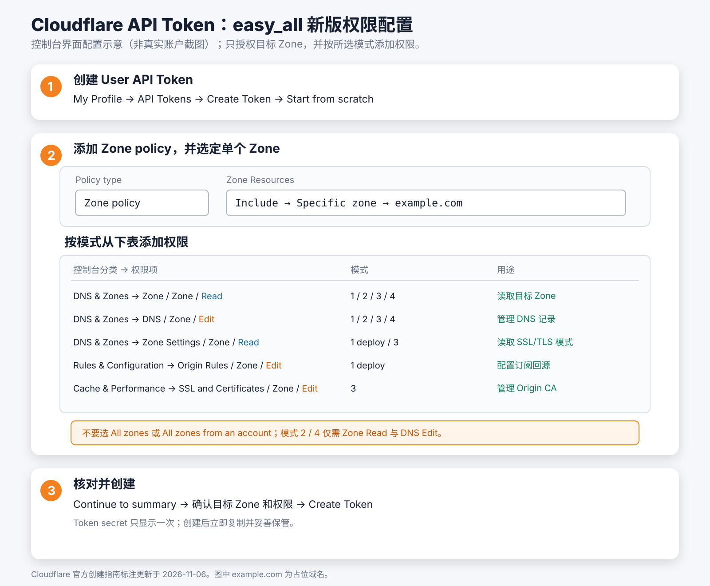

# 前置准备手册

本手册介绍部署 `easy_all` 所需准备的云端凭据：**Cloudflare API Token**（全模式）与 **AWS 访问密钥**（仅模式 4/5）。

## 凭据需求一览

| 部署模式 | Cloudflare API Token 权限要求 | AWS 访问密钥（IAM） |
| :--- | :--- | :---: |
| **模式 1 AnyTLS 直连** | `link`: Zone Read + DNS Edit<br>`deploy`: Zone Read + DNS Edit + Zone Settings Read + Origin Rules Edit | 不需要 |
| **模式 2 纯 CloudFlare** | Zone Read + DNS Edit + Zone Settings Read + SSL and Certificates Edit | 不需要 |
| **模式 3 AnyTLS + CloudFlare** | Zone Read + DNS Edit + Zone Settings Read + Origin Rules Edit | 不需要 |
| **模式 4 纯 CloudFront** | Zone Read + DNS Edit | **需要** |
| **模式 5 AnyTLS + CloudFront** | Zone Read + DNS Edit | **需要** |

---

## 开始前：SSH 连接保活（建议配置）

安装过程包含系统更新、内核与网络优化（约 5~15 分钟），SSH 偶发空闲超时会导致安装中断。建议在本地客户端配置保活（写入本机 `~/.ssh/config`，对所有 VPS 生效；**务必追加在文件最底部**，因 SSH 配置按从上到下首个匹配项生效，放顶部会影响其他主机的特定配置）：

```sshconfig
# 追加到本机 ~/.ssh/config 最底部（务必放最下面）
Host *
    ServerAliveInterval 30
    ServerAliveCountMax 6
    TCPKeepAlive yes
```

- **临时连接参数**：`ssh -o ServerAliveInterval=30 -o ServerAliveCountMax=6 <用户>@<IP> -p <端口>`。
- **会话防中断**：建议在 VPS 上的 `tmux` 或 `screen` 会话中执行；若因切网等原因中断，重新登录后再次执行安装命令即可自动检测断点并提示续装。

---

## 1. Cloudflare API Token 准备（全模式）

部署时需提供已托管目标域名的 Cloudflare API Token，用于自动化 DNS 解析、证书签发与回源规则配置。

### 1.1 权限明细对照

请遵循最小权限原则，仅授予目标 Zone（`Specific zone`）所需的权限：

| 权限分类与项目 | 适用模式 | 作用说明 |
| :--- | :--- | :--- |
| `Zone / Zone / Read` | 全模式 (1-5) | 读取目标 Zone 状态与 ID |
| `DNS / Zone / Edit` | 全模式 (1-5) | 自动管理 A、CNAME 及 ACM/Certbot DNS 验证记录 |
| `Zone Settings / Zone / Read` | 模式 1 deploy / 模式 2 / 模式 3 | 校验 Zone SSL/TLS 是否为 `Full (strict)` |
| `Origin Rules / Zone / Edit` | 模式 1 deploy / 模式 3 | 维护订阅/节点回源 8443 端口的 Origin Rule |
| `SSL and Certificates / Zone / Edit` | 模式 2 | 签发与管理 Cloudflare Origin CA 证书 |

> [!NOTE]
> - 模式 4/5 边缘证书由 AWS ACM 托管，Cloudflare 仅作权威 DNS，**只需 Zone Read 与 DNS Edit**。
> - Token 在安装时输入，以 `0600` 权限安全保存于 VPS 本机 `/etc/easy_all/cloudflare.token`。

### 1.2 创建步骤

1. 登录 [Cloudflare 控制台](https://dash.cloudflare.com/)，进入右上角头像 → **My Profile** → **API Tokens** → **Create Token**。
2. 选择 **Start with a Zone policy**（或 Create Custom Token）。
3. **Scope 范围**：`Zone Resources` 选 `Include` → `Specific zone` → 选择本次部署使用的域名 Zone。
4. **Permissions 权限**：根据上表添加所选模式需要的权限项。
5. 点击 **Continue to summary** 并创建，妥善保存生成的 Token。



---

## 2. AWS 凭证准备（仅模式 4/5）

模式 4 与模式 5 使用 AWS CloudFront 分发与 AWS Certificate Manager (ACM) viewer 证书。模式 1、2、3 无需 AWS 凭据。

### 2.1 账号与区域要求

- **全球商业区账号**：使用 AWS 全球标准账号（不支持中国区）。
- **证书固定区域**：CloudFront 的 viewer 证书必须位于 **`us-east-1`（弗吉尼亚北部）**，脚本固定在此区域调用 ACM 申请与校验。
- **内存安全使用**：AWS 密钥在安装时输入，**仅暂存于当前进程内存，不落盘**（不写入 state、日志或订阅）；亦可通过环境变量 `AWS_ACCESS_KEY_ID` 与 `AWS_SECRET_ACCESS_KEY` 预先传入。
- **费用保护**：本机内置 985 GB 近似流量计量保护，达到阈值自动阻断 CDN 入口，降低超额扣费风险。

### 2.2 创建 IAM 策略与专用用户

#### 第一步：创建最小权限策略

1. 登录 AWS 控制台，进入 **IAM** → **Policies（策略）** → **Create policy**。
2. 切换到 **JSON** 标签页，粘贴以下策略并命名为 `EasyAllCloudFrontPolicy`：

```json
{
  "Version": "2012-10-17",
  "Statement": [
    {
      "Sid": "ACMCertificateManagement",
      "Effect": "Allow",
      "Action": [
        "acm:RequestCertificate",
        "acm:DescribeCertificate",
        "acm:AddTagsToCertificate",
        "acm:ListCertificates",
        "acm:ListTagsForCertificate",
        "acm:DeleteCertificate"
      ],
      "Resource": "*",
      "Condition": {
        "StringEquals": {
          "aws:RequestedRegion": "us-east-1"
        }
      }
    },
    {
      "Sid": "CallerIdentity",
      "Effect": "Allow",
      "Action": ["sts:GetCallerIdentity"],
      "Resource": "*"
    },
    {
      "Sid": "CloudFrontDistributionManagement",
      "Effect": "Allow",
      "Action": [
        "cloudfront:CreateDistribution",
        "cloudfront:GetDistribution",
        "cloudfront:GetDistributionConfig",
        "cloudfront:UpdateDistribution",
        "cloudfront:ListDistributions",
        "cloudfront:DeleteDistribution"
      ],
      "Resource": "*"
    }
  ]
}
```

#### 第二步：创建用户并生成 Access Key

1. 在 IAM 中进入 **Users（用户）** → **Create user**，用户名填写 `easy_all-cloudfront-deployer`（**切勿勾选**提供控制台访问权限）。
2. 在权限选项中选择 **Attach policies directly**，勾选刚刚创建的 `EasyAllCloudFrontPolicy` 并完成创建。
3. 进入该用户详情页，切换到 **Security credentials** 标签页。
4. 在 **Access keys** 区域点击 **Create access key**，场景选择 **CLI**，完成创建并妥善保存：
   - **Access Key ID**
   - **Secret Access Key**（仅显示一次）

> [!TIP]
> **新 AWS 账号开通提示**：若账号注册于 2021 年末之后，首次创建 CloudFront 分发时若报 `Your account must be verified`，前往 [AWS Support](https://console.aws.amazon.com/support/home) 提交工单（类别 `Account and billing` → `Account verification`）申请开通 CloudFront 生产访问。工单通常需要 24 小时以上才有人处理；批准后重新运行安装将自动幂等复用已创建的证书与 DNS。
