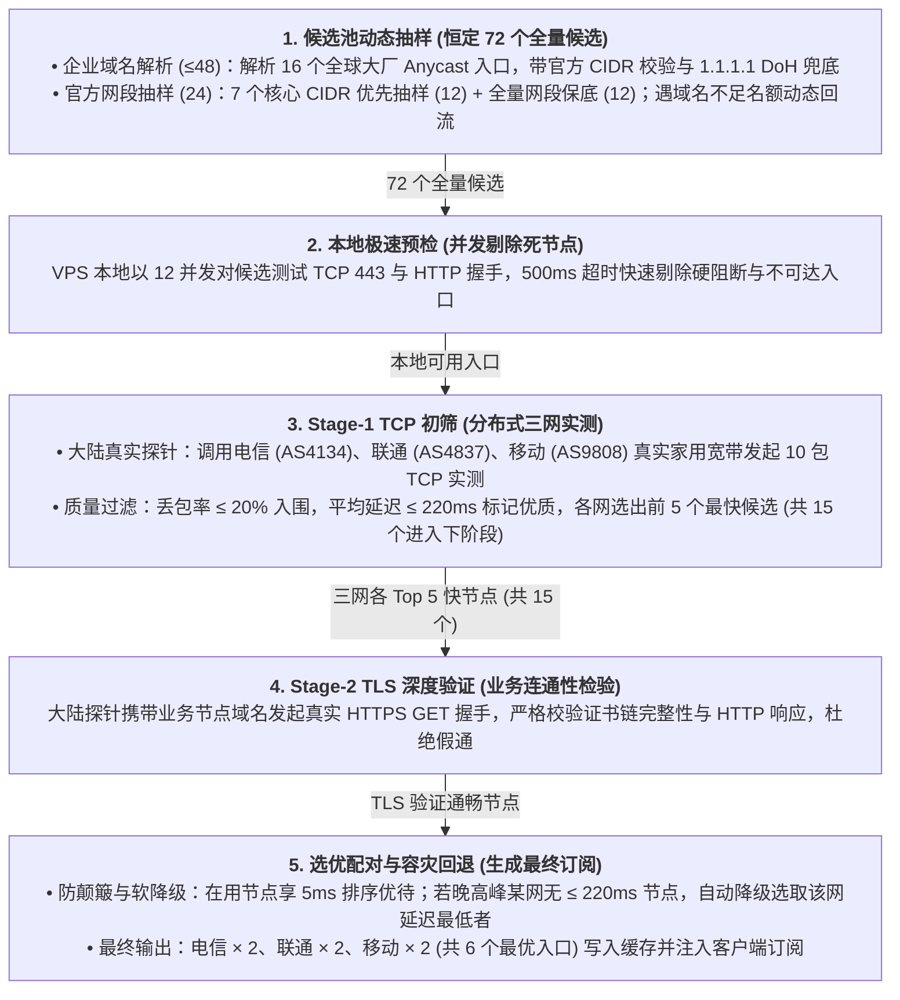

# 系统架构与技术参考

本文档记录 `easy_all` 的系统架构设计、网络拓扑、流控与安全策略以及模块职责划分。

---

## 1. 架构总览与网络拓扑

`easy_all` 支持在 Debian 12/13 与 Ubuntu 22.04/24.04 LTS 环境下以单机独占形式部署以下模式：

### 1.1 模式 1：直连 Reality
- **协议栈**：VLESS TCP Reality Vision (`flow: xtls-rprx-vision`)
- **服务端端口**：Xray 监听 `0.0.0.0:443`。
- **伪装目标**：默认 `swdist.apple.com:443`，安装和修改时通过 `xray tls ping` 自动完成带 SNI 的 TLS 1.3 握手验收。
- **Short ID 格式约束**：`REALITY_SHORT_ID` 严格约束为 1–8 对（2–16 位）偶数位十六进制字符（`^([0-9a-fA-F]{2}){1,8}$`），写入 Xray 配置与下发前均经正则断言，防止奇数位破坏 Xray 配置解析。
- **动态端口（可选）**：通过 UFW `before.rules` 在 `PREROUTING` 链将 `10000-62703` 范围端口通过单条范围规则 NAT 重定向到实际入站端口（默认 `443`），客户端按时间槽位动态轮换；算法自动探测并避让系统实际的 SSH 监听端口。
- **订阅（可选）**：`deploy` 模式由本机 Nginx 经 Cloudflare 回源下发 Mihomo YAML / Base64，订阅配置与两种 CDN 模式共用同一份 `{"allowedTokens":{...},"nodes":[...]}`：`PROXY`（`select`）依次是本机 Reality 节点、聚合 JSON 的 `nodes`；标记 `optional` 的节点仅在 URL 追加 `&node=all` 时下发。`link` 模式只输出本机节点信息。

### 1.2 模式 2：纯 CDN（Cloudflare XHTTP）
一台 VPS 只承载 CDN 入口，不监听直连 Reality：
```text
公网 443   Nginx
  ├─ cf.<zone>            → 127.0.0.1:10086 Xray VLESS XHTTP stream-up（Cloudflare 官方回源）
  └─ sub.<zone>           → 本地订阅分发（Mihomo YAML / Base64）
```
- **端口划分**：CDN 回源与订阅共用 `443`，没有 `8443` 直连入站。
- **证书管理**：`cf` 与 `sub` 共用一张 15 年有效期的 Cloudflare Origin CA ECC 证书。
- **单一订阅**：订阅下发「Cloudflare 优选 6 个」+「CDN 域名官方调度兜底 1 个」。Mihomo 侧固定分组：`PROXY`（`select`）依次是聚合 JSON 的 `nodes`、`CDN-FALLBACK`；`CDN-AUTO`（`url-test`）只放 Cloudflare 优选 1～6；`CDN-FALLBACK`（`fallback`）先选 `CDN-AUTO`，全部不可用时落到连接 `cf.<zone>` 的兜底节点，由 Cloudflare 官方 Anycast 调度决定边缘。标记 `optional` 的节点仅在 URL 追加 `&node=all` 时下发。

### 1.3 模式 3：直连+CDN（Reality + Cloudflare XHTTP）
一台 VPS 独占承载直连与 CDN 两个入口：
```text
公网 8443  Xray VLESS Reality（直连入口，伪装目标另配 SNI）
公网 443   Nginx
  ├─ cf.<zone>            → 127.0.0.1:10086 Xray VLESS XHTTP stream-up（Cloudflare 官方回源）
  └─ sub.<zone>           → 本地订阅分发（Mihomo YAML / Base64）
```
- **端口划分**：直连入站固定在 `8443`，CDN 回源与订阅共用 `443`。
- **证书管理**：与纯 CDN 模式相同，`cf` 与 `sub` 共用一张 Cloudflare Origin CA ECC 证书。
- **单一订阅**：订阅下发「直连 1 个」+「Cloudflare 优选 6 个」+「CDN 域名官方调度兜底 1 个」。`PROXY`（`select`）依次是本机直连、聚合 JSON 的 `nodes`、`CDN-FALLBACK`；`CDN-AUTO`（`url-test`）只放 Cloudflare 优选 1～6，聚合节点与兜底节点都不参与测速。标记 `optional` 的节点仅在 URL 追加 `&node=all` 时下发。

---

## 2. 防火墙与安全边界

### 2.1 SSH 端口保持与保护
- **端口保持与防火墙策略**：
  - 各模式均保留系统原有 SSH 监听端口（默认 22），不强行迁移端口，避免因云安全组限制导致失联。
  - UFW 设置默认入站拒绝，仅放行必要端口，未放行端口由默认策略阻断。
  - Fail2ban 自动配置 sshd jail 实时监控保护实际 SSH 端口。
- **常驻安全基线归初始化**：`scripts/debian-init.sh` 负责激活 UFW（SSH 端口、ICMP 回显与出站放行）并配置 Fail2ban；easy_all 安装只在此基础上追加业务端口。
- **规则规格删除防编号漂移**：业务端口与回源白名单的清理升级为规则规格删除（通过 `stale_ufw_rule_delete_specs` 生成规格并执行 `ufw delete`），替代易受并发插桩干扰的行号逆序删除，彻底规避了 Fail2ban 动态插入规则导致的编号漂移与误删。
- **卸载与回滚只回收业务端口**：各模式 `uninstall` 与安装失败回滚一律只删除自己注入的 443/8443 放行、动态端口 NAT 重定向与 CDN 回源白名单，保留 UFW 启用状态、默认策略、SSH 放行与 Fail2ban 配置，不再执行 `ufw disable`。
- **Fail2ban 助手脚本解耦**：CIDR 封禁助手安装到 `/usr/local/sbin/fail2ban-ufw-cidr.sh`（不再位于 `/usr/local/lib/easy_all`），卸载 easy_all 时保留，避免常驻 SSH 封禁动作因脚本缺失而失效。
- **重装跳过已就绪的初始化**：卸载后重装时，依赖包、Swap、内核与 TCP 加速已就绪就跳过重复安装；IPv4-only、定时重启与 UFW/Fail2ban 仍会幂等校验。
- **定时维护互斥与安全加固**：每日定时重启任务引入运行时写锁检测（`flock -n 8`），检测到后台有安装或更新进行时自动跳过重启并向 syslog 记录审计日志，防止并发维护造成半安装现场；crontab 任务命令统一对 `%` 进行了转义。

### 2.1.1 各模式开放端口

| 模式 | 全局放行 | 仅回源白名单放行 | 其他 |
| --- | --- | --- | --- |
| 初始化（debian-init） | SSH 实际监听端口 | — | ICMP 回显（UFW 默认）与全部出站；UFW 默认入站拒绝 |
| 1 直连 Reality | TCP 443 | TCP 8443（仅订阅模式非 `link` 时，Cloudflare 订阅回源） | 动态端口模式在 `PREROUTING` 注入 `10000:62703` → 实际入站端口（默认 443）NAT |
| 2 纯 CDN | — | TCP 443（Cloudflare 官方 IPv4 回源段） | 无直连入口，业务端口仅 CDN 回源与订阅 |
| 3 直连+CDN | TCP 8443（Reality 直连） | TCP 443（Cloudflare 官方 IPv4 回源段） | 两入口共用同一套 UFW/Fail2ban 基线 |

### 2.2 回源白名单与防扫描
- 在涉及 Cloudflare 的模式中，本地 Nginx 与防火墙严格限制：
  - UFW 仅向 Cloudflare 官方公布的 IPv4 网段开放各模式的回源端口（模式 1：TCP `8443`，模式 2/3：TCP `443`）；
  - 外部扫描器直接探测源站 IP 对应端口会被防火墙静默丢弃（DROP）。

### 2.3 恶意出站与内部阻断
- Xray 服务端默认配置阻断私网地址（RFC 1918）、链路本地地址（169.254.0.0/16）、回环地址以及云厂商元数据接口。
- 拒绝境外 UDP/443 请求，强制 QUIC 连接降级回退至 TCP（服务端 Udp/443 也有独立 block 路由）。
  客户端 Mihomo 模板的嗅探（`sniffer`）同样不覆盖 QUIC：否则这次拒绝会被握手解析拖慢
  （Android 上表现为 Google Play 下载长期停在“等待中”）。

---

## 3. 订阅分发与自适应机制

- **原子渲染**：订阅文件在生成时先写入临时暂存目录，校验完整无缺后原子替换，防止高并发下载时读到半截内容。
- **客户端自适应**：
  - 根据 HTTP 请求头中的 `User-Agent` 自动识别客户端；
  - Clash / Mihomo 客户端自动返回格式合法的 YAML 订阅（采用最新 MRS 规则集）；
  - 通用客户端返回经过 Base64 编码的节点 URI 列表；
  - 亦支持在 URL 参数中追加 `flag=clash` 或 `flag=base64` 强制指定下发格式。
- **平台自适应（嗅探段）**：默认模板开启 `sniffer`。UA 命中 `iphone|ipad|ipod|ios`（`ios` 需独立单词，避免 `Studios`/`Radios` 之类 UA 被误判）或在 URL 追加 `os=ios` 时，
  下发单独渲染的 YAML（`mihomo-ios.yaml` / `mihomo-ios.port-template`），剔除以 `sniffer:` 开头的整段配置（兼顾 iOS 内存预算、防 APNs 推送干扰、私有协议首包延迟与 CDN 调度劣化）；
  模板若把 `sniffer` 写成内联映射，安装会直接报错，不会静默下发未剔除的嗅探段。

---

## 4. Cloudflare CDN 优选 IP 原理与实现

### 4.1 核心原理
Cloudflare 全球 Anycast 边缘网络对中国大陆公网访问调度并不均一：
- 默认 DNS 往往将大陆流量路由至美东、欧洲等绕路节点（RTT 280ms+ 且丢包严重），仅少量优质网段（如美西旧金山/圣何塞机房）能保持较低延迟（140ms~200ms）；
- 全球大型企业/政府客户（如 OpenAI、Cloudflare 自身服务、Apple）常被分配至更优质的 Anycast 集群。

`easy_all` 采用**服务端中心化主动探测**机制：不耗费手机/客户端电量，由服务端定期（默认 3 小时定时器）通过多点分布式探针（Globalping API），从大陆三大运营商（中国电信 AS4134、中国联通 AS4837、中国移动 AS9808）的真实终端（eyeball-network）角度，经过**两阶段筛选**选出 6 个（三网各 2 个）最低延迟、低丢包且 TLS 真正通畅的优选 IP 注入订阅。

### 4.2 管道化实现架构

优选 IP 核心流程由 [`lib/cloudflare-ip-pool.sh`](../lib/cloudflare-ip-pool.sh) 编排，分层执行：



1. **分段配额抽样（样本池 72 个）**：
   - **企业大厂域名（上限 48 个，占 2/3）**：并发解析 16 个全球知名服务域名（`speed.cloudflare.com`、`openai.com` 等）的 A 记录，严格要求解析结果必须位于 Cloudflare 官方 CIDR 内；若遇境内 DNS 污染，自动安全回退至 `1.1.1.1` DoH 解析；
   - **优先官方 CIDR（12 个，占 1/6）**：针对 7 个核心历史网段（`104.16.0.0/13`、`172.64.0.0/13` 等），按每小时时间槽 `epoch` 结合响应式主机散列离散抽样；
   - **全量官方 CIDR（12 个，占 1/6）**：对 Cloudflare 全量 IPv4 范围做保底离散抽样；
   - **名额动态回流**：企业域名解析不足或离线时，剩余名额自动回流给网段抽样，初筛候选池严格补足 72 个，防止池子萎缩。
2. **本机 CDN 入口预检**：
   - 服务端本地以 12 并发对 72 个候选快速测试 TCP 443 端口与 HTTP 握手，提前剔除已被宿主网络封锁的死节点。
3. **Stage-1：Globalping 三网 TCP 探针初筛**：
   - 提交大陆三大运营商真实探针（每节点 10 包 TCP ping），筛选丢包率 $\le 20\%$ 的候选，并为平均延迟 $\le 220\text{ms}$ 的节点标记 `rtt_ok`；
   - 按运营商分组排序（`rtt_ok` 优先，其次丢包率与 RTT），三网各截取排名前 5 的快节点（共 15 个）进入下一阶段。
4. **Stage-2：Globalping HTTP/TLS 深度验证（防 SNI 假通）**：
   - 针对初筛出的 15 个节点，由大陆探针携带业务节点域名（`VLESS_CDN_DOMAIN`）发起真实的 HTTPS GET 握手，验证证书链与 HTTP 响应状态，杜绝“TCP 端口通但 SNI 握手被 RST 阻断”的假通节点。
5. **运营商分配与平滑回退**：
   - 历史有效候选享有 5ms 排序优待，避免节点频繁颠簸；
   - **晚高峰软降级兜底**：若某运营商在国际拥堵时段无可满足 $\le 220\text{ms}$ 的候选，算法自动回退至该网丢包合格中延迟最低的候选，绝不因单网波动而一票否决整个选优流程；
   - 最终产出电信 2 个、联通 2 个、移动 2 个（共 6 个）独立 IP，打上清晰标签（`电信01/02`、`联通01/02`、`移动01/02`）并写入持久化缓存。

---

## 5. 目录结构与模块划分

```text
easy_all
├── bootstrap.sh                 # 远程一键安装拉取器
├── easy_all                     # CLI 统一管理入口与命令调度
├── runtime.manifest             # 运行时受管文件清单
├── profiles/
│   ├── reality.sh               # 模式 1：直连 Reality 业务编排
│   ├── cdn.sh                   # 模式 2：纯 CDN 业务编排
│   └── combined.sh              # 模式 3：直连+CDN 业务编排
├── lib/
│   ├── log.sh                   # 日志与双语输出
│   ├── platform.sh              # 系统环境、Debian 探测与基础依赖
│   ├── runtime-core.sh          # 跨模式通用运行时
│   ├── profile-common.sh        # Profile 通用流程、状态持久化与回滚
│   ├── network.sh               # 网络与 IPv4/域名基础校验
│   ├── reality-target.sh        # Reality 伪装目标校验与 ASN 探测
│   ├── reality-subscription.js  # 本地自托管订阅生成器
│   ├── cloudflare-ip-pool.sh    # Cloudflare 候选 IP 池与抽样验证
│   ├── globalping-cdn.sh        # Globalping 探针调用与三网优选
│   ├── cf-dns.sh                # Cloudflare API / DNS / Origin CA / 回源白名单
│   ├── cloudflare-mode.sh       # 两种 CDN 模式共用的编排、订阅渲染与生命周期
│   ├── cloudflare-purge.sh      # Cloudflare 远端托管资源识别与清理
│   ├── xhttp-runtime.sh         # XHTTP 运行时公共逻辑与证书挂载
│   ├── firewall.sh              # UFW 规则配置与状态快照
│   ├── subscription-auth.sh     # 订阅凭据生成与校验
│   ├── local-aggregation.sh     # 本地聚合节点校验与渲染（全模式共用）
│   ├── scheduled-maintenance.sh # 定时重启与维护任务
│   ├── tcp-tuning.sh            # Skyline Speeder 与 Zabbly 6.12+ LTS 内核管理
│   ├── xray-core.sh             # Xray 官方二进制下载与校验
│   └── mihomo-template.sh       # Mihomo 订阅模板结构校验与渲染
├── templates/                   # 内置 Mihomo 订阅配置模板
│   ├── mihomo.yaml              # 默认 COMMON 精简规则模板
│   ├── mihomo-common.yaml       # 完整 COMMON 规则模板
│   └── mihomo-classic.yaml      # 经典 MRS 规则集模板
└── scripts/                     # 辅助构建与系统初始化脚本
    └── debian-init.sh           # 独立系统初始化加固工具（Debian 12/13、Ubuntu 22.04/24.04）
```
